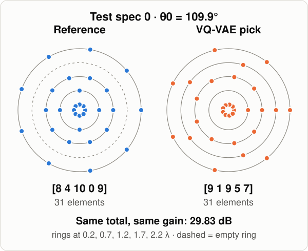
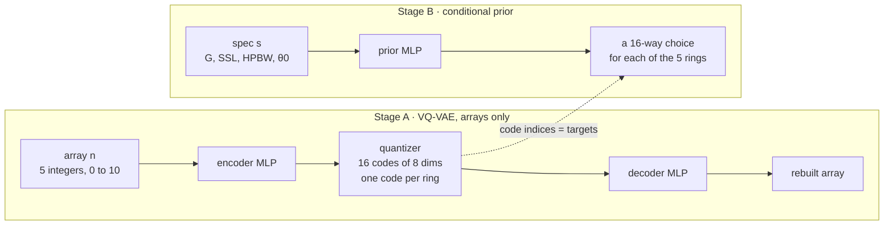
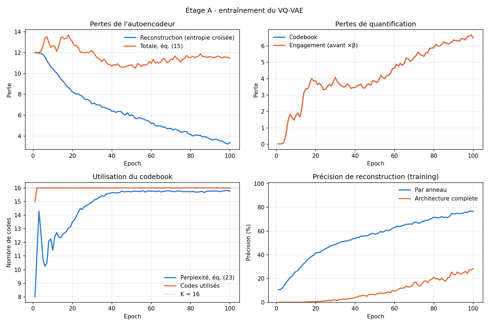
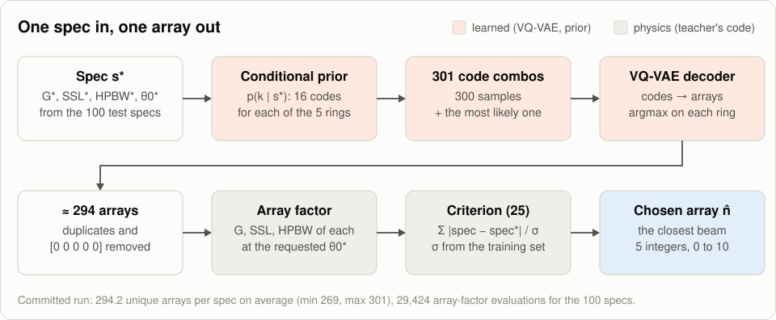
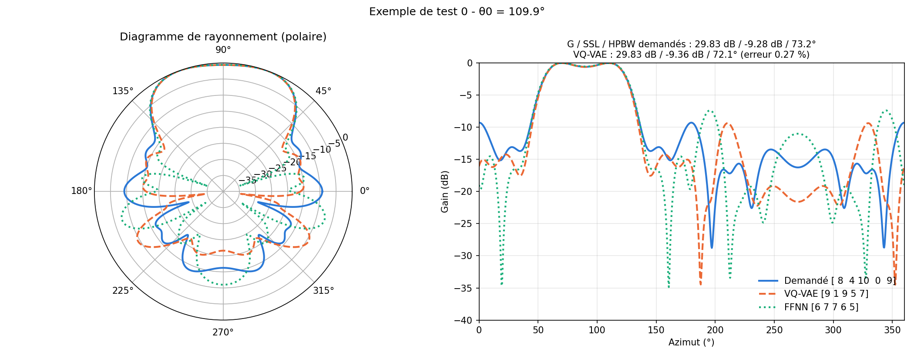
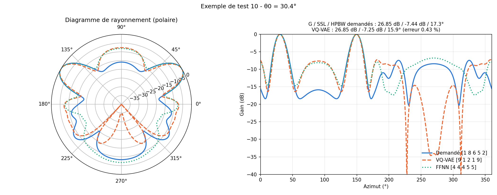
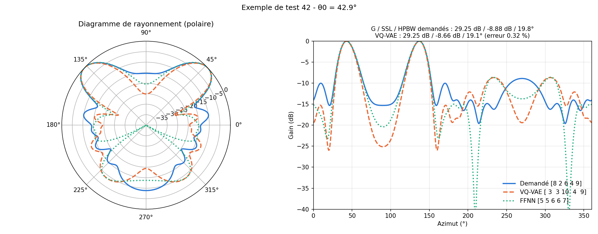
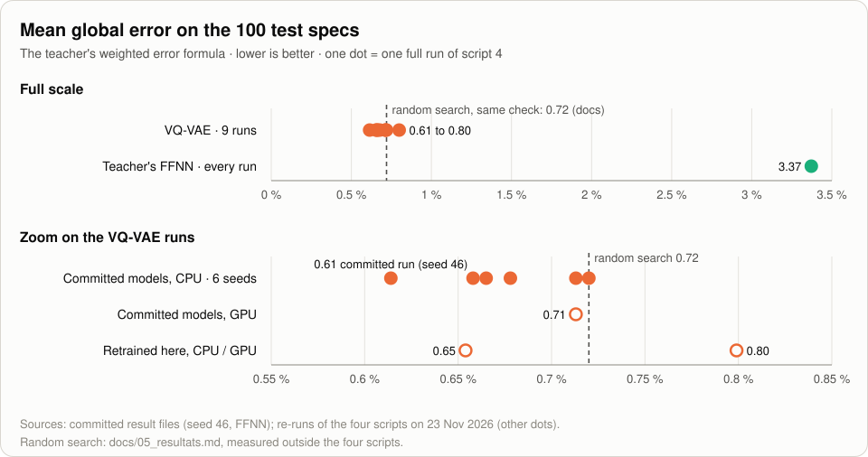

<div align="center">

# VQ-VAE Antenna Inverse Design

### Propose 300 arrays. Let the physics choose.

You give the beam you want: gain, side-lobe level, beamwidth and pointing angle. A VQ-VAE with a conditional prior proposes about 300 concentric-ring antenna arrays. The teacher's array-factor code computes the beam of each one, and the closest one is kept.

**Artificial-intelligence lab · INSAT, IIA3 track · teacher: N. ISMAIL**

[Quick start](#quick-start) · [Try it in 5 minutes](#try-it-in-5-minutes) · [Results and limits](docs/05_resultats.md) · [Docs (French)](docs/README.md) · [Credits and AI use](#credits-and-ai-use)

</div>

![Test spec 77, pointing angle 2.7°, polar and Cartesian views. Blue, the requested beam ("Demandé" [1 6 6 7 8]). Orange dashes, the VQ-VAE pick [4 3 5 9 8]: its side lobes sit at −10.42 dB for −10.37 dB requested. Green dots, the teacher's FFNN [5 6 6 6 6]: its side lobes sit at −15.71 dB](diagramme_exemple_77.png)

<div align="center">

**0.61%** mean error on **100** unseen specs¹ · **3.37%** for the teacher's FFNN · better on **96 / 100** specs · **≈ 294** arrays checked per spec · trained on **900** of **161,050** possible arrays

<sub>¹ The teacher's weighted error formula, committed run (CPU, seed 46). Five other seeds give 0.66 to 0.72%. Random search with the same check gives 0.72% (docs). See <a href="#06--what-the-prior-really-adds">§06</a>. The plot above is <code>diagramme_exemple_77.png</code>, written by script 4.</sub>

</div>

---

## Ask for a beam. Get an array.



Picture a 2.45 GHz antenna array, in the Wi-Fi band, made of five concentric rings. Each ring holds 0 to 10 antennas. Test spec 0 asks for **29.83 dB** of gain, side lobes at **−9.28 dB** and a **73.2°** beamwidth, pointed at **θ0 = 109.9°**.

### Now find the array.

- **161,050 arrays are possible:** 11 choices on each of the 5 rings, minus the empty array.
- **Many of them are right.** The gain depends only on the total number of antennas. [8 4 10 0 9] and [9 1 9 5 7] both have 31, so both give 29.83 dB.
- **A regression network averages the right answers.** Trained on squared error, the course's FFNN predicts "middle" arrays: 74% of its ring values fall between 4 and 7.
- **Only the beam can be checked.** The array is a means. The spec is the target.

**This project proposes about 300 arrays per spec, computes the beam of each with the teacher's array-factor code, and keeps the closest.** For spec 0 it picks [9 1 9 5 7]: error 0.27%, against 1.76% for the FFNN.

<br clear="right">

---

## 01 · Five rings. Four numbers.

The rings sit at 0.2, 0.7, 1.2, 1.7 and 2.2 λ (λ ≈ 12.24 cm). An array is 5 integers, one per ring, each from 0 to 10. A spec is 4 numbers:

| Spec | What it is | Range in the dataset |
|---|---|---|
| **G** | main-lobe gain, 20·log10 of the array-factor peak | 12.0 to 33.4 dB |
| **SSL** | highest side lobe, relative to the main lobe | −38.7 to −1.3 dB |
| **HPBW** | main-lobe width at −3 dB | 11.2 to 113.5° |
| **θ0** | pointing direction: the condition, not a target | 0.1 to 179.7° |

The dataset is 1,000 random arrays and their computed specs (seed 46), split into **900** for training and **100** for the test. It is the dataset of the teacher's FFNN (§04). Details: [`docs/01_dataset.md`](docs/01_dataset.md).

<details>
<summary><b>The array factor</b></summary>

Computed in the φ = 0 cut, on 1,000 angles θ ∈ [0, 2π], with φ_n = 2πn / n_r the angle of element n on ring r:

```math
\mathrm{AF}(\theta)=\sum_{r=1}^{5}\sum_{n=0}^{n_r-1}\exp\Big(j\,k\,a_r\big[\sin\theta\cos(\phi-\phi_n)-\sin\theta_0\cos(\phi_0-\phi_n)\big]\Big),\qquad k=\frac{2\pi}{\lambda}
```

In the pointing direction all phases align, so G = 20·log10(Σ n_r). On the 1,000 samples, the computed G matches that to within 0.0007 dB.

</details>

---

## 02 · Learn the arrays. Then condition on the beam.

Training runs in two stages, about 11 s on our laptop ([`docs/03_entrainement.md`](docs/03_entrainement.md)).



- **Stage A, the VQ-VAE (57,823 parameters).** It never sees a spec. Each ring becomes one 8-number vector, snapped to the nearest of **16 codes**, and the decoder rebuilds the array. After 100 epochs it rebuilds **76.4%** of training rings and **28.3%** of whole arrays, and uses all 16 codes (perplexity 15.76 of 16).
- **Stage B, the conditional prior (43,984 parameters).** The autoencoder is frozen. Each training array becomes 5 code indices, and an MLP learns which code each ring should take for a given spec. It names the right code for **17.7%** of training rings; chance is 6.25%.

<details>
<summary><b>Training curves</b> (<code>courbes_VQVAE.png</code>, written by script 3)</summary>
<br>



The "Codebook" and "Engagement" curves have the same values by construction, so the blue one is hidden under the orange one. The reconstruction loss is still falling at epoch 100.

</details>

---

## 03 · Propose 300. Check them all. Keep one.

<p align="center"></p>

1. **Sample.** For each ring the prior gives a probability over the 16 codes. Script 4 draws 300 combinations, and adds the most likely one.
2. **Decode.** Each combination becomes an array. Duplicates and the empty array are dropped: **294** arrays are left on average (269 to 301).
3. **Check.** The teacher's function computes G, SSL and HPBW of each array, at the requested θ0.
4. **Keep the closest**, by the criterion below.

```math
\hat{\mathbf{n}}=\arg\min_i\;\frac{|G^{(i)}-G^{\ast}|}{\sigma_G}+\frac{|\mathrm{SSL}^{(i)}-\mathrm{SSL}^{\ast}|}{\sigma_{\mathrm{SSL}}}+\frac{|\mathrm{HPBW}^{(i)}-\mathrm{HPBW}^{\ast}|}{\sigma_{\mathrm{HPBW}}}
```

The σ come from the training set (2.89 dB, 3.05 dB, 24.96°), so dB and degrees count on the same scale. The price: about 294 array-factor evaluations per spec, where the FFNN needs one.

---

## 04 · Same data. Same judge.

The FFNN comes with the course. For a fair comparison, everything except the model is the teacher's.

| Check | How it holds |
|---|---|
| Same 1,000 samples | Same seed (46) and the same draw order as the teacher's dataset script. Our training-set min and max equal the teacher's `normalization_params.npz` exactly. |
| Same 100 test specs | Same shuffle (seed 46), 900 / 100. None of the 100 test arrays is in the training set. |
| Same physics | The teacher's array-factor function, copied unchanged and marked in the code. The test specs it recomputes match `Minput_test` exactly. |
| Same score | The teacher's error lines, copied: 0.33·e_G + 0.33·e_SSL + 0.34·e_HPBW, each error relative to max G, max \|SSL\| or 180°. |
| Same FFNN | The teacher's trained weights, `ffnn_model.pth`, run on the same 100 specs and rounded to integers as in his script. |

| On the 100 test specs | VQ-VAE | Teacher's FFNN |
|---|---|---|
| **Mean global error** | **0.61%** | 3.37% |
| Median · 90th percentile · worst | 0.54 · 1.10 · 2.13% | 2.99 · 6.67 · 8.23% |
| Mean absolute error G | 0.13 dB | 0.33 dB |
| Mean absolute error SSL | 0.23 dB | 2.98 dB |
| Mean absolute error HPBW | 1.49° | 2.70° |
| Better on | 96 specs | 4 specs |
| Reference array found exactly | 0 / 100 | 0 / 100 |
| Time per spec, committed run | 1.04 s | 0.0035 s |

Neither model finds the reference array, and neither needs to: many arrays meet the same spec. The FFNN gets the gain right but not the side lobes. Its arrays are too even: per ring, their standard deviation is 1.58, against 3.13 for the reference arrays and 3.19 for the VQ-VAE's. Full results: [`docs/05_resultats.md`](docs/05_resultats.md).

---

## 05 · Four specs, side by side.

<table>
<tr>
<td width="50%" align="center"><br><b>Spec 0 · θ0 = 109.9°</b><br><sub>VQ-VAE [9 1 9 5 7] 0.27% · FFNN [6 7 7 6 5] 1.76%</sub></td>
<td width="50%" align="center"><br><b>Spec 10 · θ0 = 30.4°</b>, the teacher's own example<br><sub>VQ-VAE [9 1 2 1 9] 0.43% · FFNN [4 4 4 5 5] 0.57%</sub></td>
</tr>
<tr>
<td width="50%" align="center"><br><b>Spec 42 · θ0 = 42.9°</b><br><sub>VQ-VAE [3 3 10 4 9] 0.32% · FFNN [5 5 6 6 7] 0.39%</sub></td>
<td width="50%" align="center"><br><b>All 100 specs</b><br><sub>The side lobes make the difference: mean relative SSL error 0.61% against 7.70%</sub></td>
</tr>
</table>

<sub>In each pattern, blue "Demandé" is the reference array's beam, orange the VQ-VAE, green the FFNN. The axis the code titles "Azimut" is the angle θ in the φ = 0 cut. Spec 77 is at the top of this page.</sub>

---

## 06 · What the prior really adds.

<p align="center"></p>

Is the gain from the learned prior, or from the checking?

- **Random search** draws 301 arrays at random and applies the same check: **0.72%** ([`docs/05_resultats.md`](docs/05_resultats.md), measured outside the four scripts).
- **The VQ-VAE's 0.61% is one draw of the candidates.** With the same models on CPU, five other seeds give **0.66 to 0.72%**. A GPU draws differently: 0.71%. Retraining on our laptop gave 0.65% on CPU and 0.80% on GPU.
- **So the physics check does most of the work:** 3.37% down to about 0.7%. The learned prior adds a little on top of random search, about as much as the spread between seeds.
- **The costs differ:** about 294 array-factor evaluations per spec for the VQ-VAE, one for the FFNN.

---

## Quick start

Windows 11, PowerShell, Python 3.12. Every line below ran on 23 Nov 2026 on a fresh clone.

```powershell
git clone https://github.com/ymhamdi/VQVAE-Antenna-Inverse-Design.git
cd VQVAE-Antenna-Inverse-Design
python -m pip install numpy scipy torch matplotlib
```

The repo has no requirements file. Tested with Python 3.12.15, numpy 2.5.5, scipy 1.18.1, torch 2.15.0 (the CPU wheel from PyPI) and matplotlib 3.11.2; the `pip` line took 41 s. On Windows, keep your virtual environment in a short folder: torch's file names can pass the 260-character path limit, and `pip` then stops with an `OSError`.

```powershell
python dataset.py                    # 1 · 1,000 random arrays and their specs
python repartition_training_test.py  # 2 · the 900 / 100 split
python VQVAE_training.py             # 3 · stage A, then stage B
python test_model_VQVAE.py           # 4 · inverse design on the 100 test specs, FFNN comparison, plots
```

On our laptop's CPU they take 1.8 s, 0.5 s, 11 s and 33 s; the docs give 2 to 5 s, under 1 s, about 25 s and about 2 min for the machine of the committed run. Each script reads and writes its files in its own folder, wherever you run it from, so these commands overwrite the committed results. `git restore .` brings them back.

**GPU.** With CUDA, scripts 3 and 4 use the GPU, and the random draws change (0.71% with the committed models). To get the committed 0.61% exactly, run script 4 on the CPU: `$env:CUDA_VISIBLE_DEVICES = "-1"` first.

### Try it in 5 minutes

1. **Re-run the test on the committed models.** `python test_model_VQVAE.py` (about 35 s). The "RÉSUMÉ DU TEST" table at the end gives the mean global error: 0.614 for the VQ-VAE on a CPU (0.713 on our GPU), 3.372 for the FFNN.
2. **Open `diagramme_exemple_77.png`.** Look at the side lobes: orange follows blue, green sits 5 dB lower.
3. **Change the draw.** Set `SEED = 1` at the top of `test_model_VQVAE.py` and run it again: 0.665%. That is the spread of §06.
4. **Retrain.** `python VQVAE_training.py`, then script 4 again. Open `courbes_VQVAE.png` and `distribution_erreurs.png`.
5. **Put everything back.** `git restore .`

<details>
<summary><b>Check the whole chain in seconds</b></summary>

```powershell
python dataset.py --rapide           # 50 samples
python repartition_training_test.py
python VQVAE_training.py --rapide    # 2 + 2 epochs
python test_model_VQVAE.py
git restore .
```

About 8 s in all on our laptop. Script 4 then tests 5 specs and warns that the split differs from the FFNN's. The numbers mean nothing: it only shows that the four scripts run end to end.

</details>

---

## Labelled honestly

| What you see | What it really is |
|---|---|
| Every G, SSL and HPBW | **Computed, not measured**: the array factor of ideal point sources, in the φ = 0 cut. No element pattern, no mutual coupling. No antenna was built or measured. |
| 0.61% | The committed run: CPU, seed 46. It is the best of the 6 seeds we ran (0.61 to 0.72%). |
| 0.72% for random search | From `docs/05_resultats.md`, measured outside the four scripts. Its script is not in the repo. |
| The FFNN | The teacher's trained model (`ffnn_model.pth`), run by script 4 on the same 100 specs. |
| Times per spec | 1.04 s and 0.0035 s come from the committed run; the machine is not recorded. On our laptop the VQ-VAE takes 0.21 to 0.30 s per spec. |
| "Same data as the FFNN" | Shown for the split: the teacher's normalization file matches our training set exactly. The teacher's own scripts and data files are not in this repo. |
| Equation numbers (15), (24), (25) | From the theoretical summary report, which is not in this repo. |
| The plots | Written by the scripts and committed. "Demandé" is the reference array's beam. "Azimut" is θ in the φ = 0 cut. |

## Limits

- **The check does most of the work.** Random search with the same check reaches 0.72%. The learned prior's edge is about the size of the seed spread.
- **Results depend on the draw and the device:** 0.61 to 0.72% across 6 seeds on CPU, 0.71% on GPU with the same models. Retraining does not give the same weights on another machine either: 0.65% on our laptop's CPU.
- **Stage A generalizes poorly.** It rebuilds 49.2% of test rings but only 3% of whole test arrays. It saw 900 of 161,050 arrays, and its loss is still falling at epoch 100.
- **The prior treats the rings as independent given the spec** (eq. (24)). It can mix rings from different solutions, and only the check makes up for it.
- **Exhaustive search is within reach.** At 0.7 to 0.8 ms per array on our laptop (as `dataset.py` reports), all 161,050 arrays would take about 2 minutes per spec (an estimate). This repo does not compare against it.
- **Array factor only:** no full-wave simulation, no prototype.
- **No automated tests and no pinned versions.** The only built-in check is in script 4: recomputed test specs equal `Minput_test`.

Ideas to go further (more arrays for stage A, an autoregressive prior) are in [`docs/05_resultats.md`](docs/05_resultats.md).

---

## Credits and AI use

- **Teacher's code (N. ISMAIL, course material):** the array-factor function `calcul_AF_performance_metrics`, the error lines, the `FFNN` class, `ffnn_model.pth` and `normalization_params.npz`. They are reproduced for the comparison and marked in the code.
- **Method:** the VQ-VAE of A. van den Oord, O. Vinyals and K. Kavukcuoglu, *Neural Discrete Representation Learning*, NeurIPS 2017 ([arXiv:1711.00937](https://arxiv.org/abs/1711.00937)).
- **Libraries** (from the imports; there is no requirements file): NumPy, SciPy (`scipy.io`, `scipy.signal.find_peaks`), PyTorch, Matplotlib.
- **AI use:** the code and docs were written with Claude (Anthropic); 5 of the 6 commits on `main` carry a `Co-Authored-By: Claude` trailer. This README was drafted with Claude Code. Every number on it was checked against a committed file or a re-run on 23 Nov 2026; the sources are listed in the pull request that added it. Every image is a plot written by the scripts or a diagram drawn for this page.

Student coursework, not an official INSAT publication.

## Team

**Youssef Mhamdi**, INSAT, IIA3.

## Documentation

In French, one page per script:

| Doc | What |
|---|---|
| [`docs/README.md`](docs/README.md) | The index |
| [`docs/01_dataset.md`](docs/01_dataset.md) | The physics, the 4 specs, the teacher's code and its traps, `Minput` / `Moutput` |
| [`docs/02_repartition.md`](docs/02_repartition.md) | The 900 / 100 split, the same as the FFNN's |
| [`docs/03_entrainement.md`](docs/03_entrainement.md) | Stage A, stage B, losses, hyperparameters, training histories |
| [`docs/04_test.md`](docs/04_test.md) | Inverse design, the teacher's error, the FFNN comparison, output files |
| [`docs/05_resultats.md`](docs/05_resultats.md) | Numbers, figures, limits and ideas |

## Layout

```text
.
├── dataset.py                    # 1 · random arrays → Minput (specs), Moutput (arrays)
├── repartition_training_test.py  # 2 · 900 / 100 split → *_training, *_test, *_indices
├── VQVAE_training.py             # 3 · stages A and B → *_model.pt, historique_*, courbes
├── test_model_VQVAE.py           # 4 · inverse design, FFNN → *_VQVAE, *_FFNN, plots
├── ffnn_model.pth                # the teacher's FFNN (scaling: normalization_params.npz)
├── *.npy, *.mat, *.npz           # committed results of the full run
├── *.png                         # training curves, example patterns, error distribution
├── docs/                         # one page per script, results and limits (French)
└── assets/readme/                # the diagrams on this page
```

`Minput` holds the specs (the model's input) and `Moutput` the arrays (its output), one column per sample: the teacher's naming. License: [MIT](LICENSE), except the teacher's code listed above.
