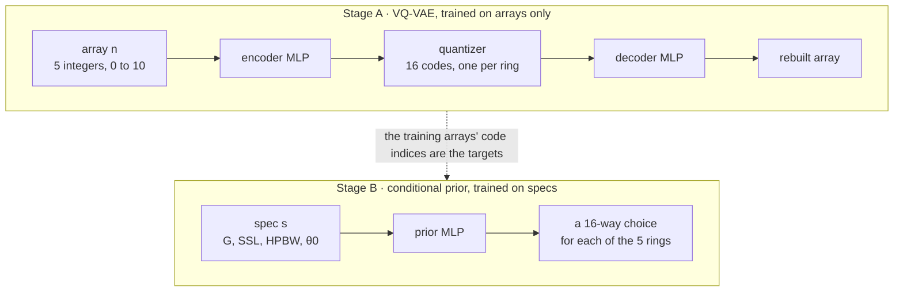
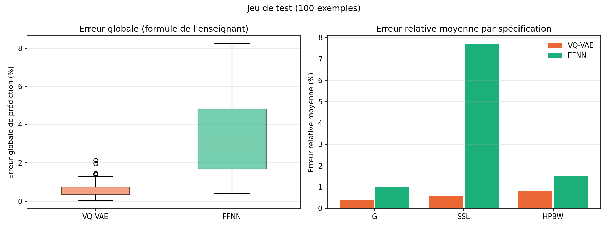
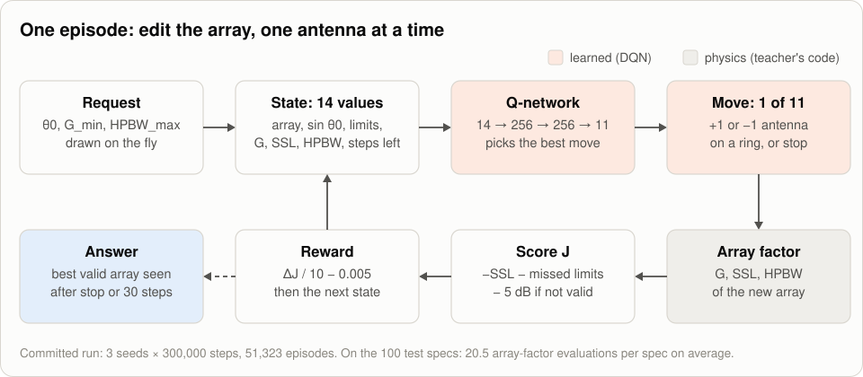
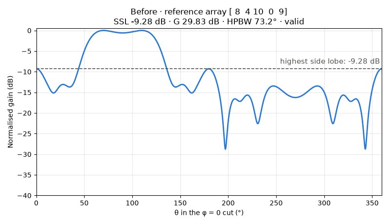
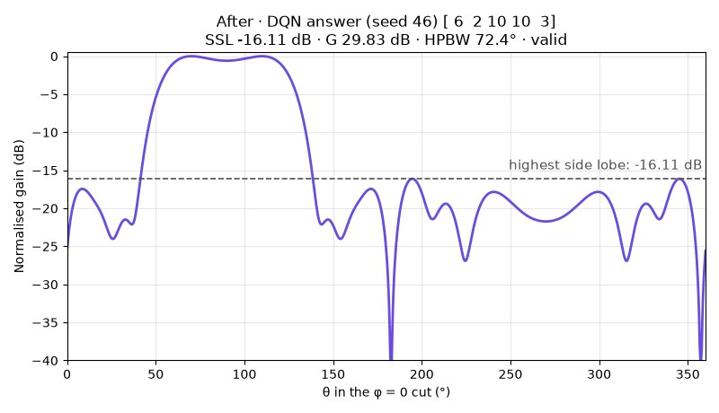
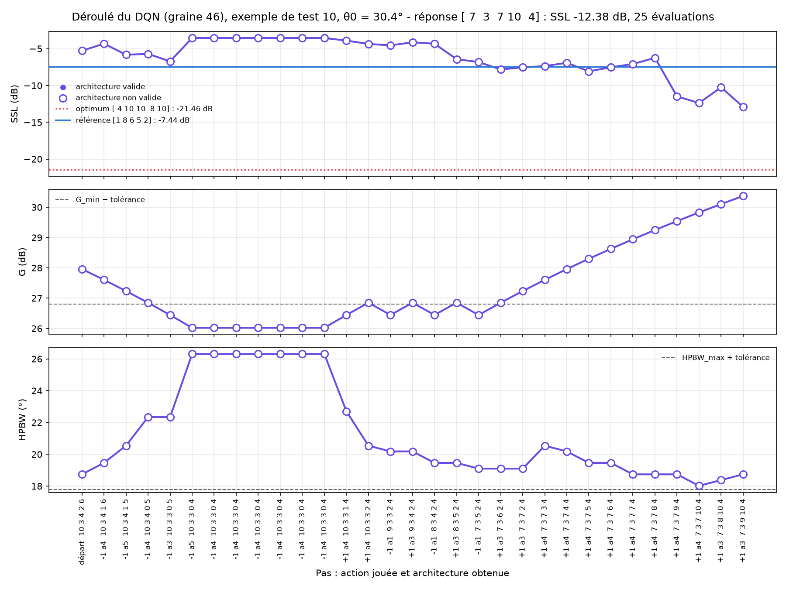

<div align="center">

# VQ-VAE Antenna Inverse Design

### One array, two questions: match the beam you ask for, or push the side lobes down.

A 2.45 GHz antenna array of five concentric rings, and two AI labs on it. A VQ-VAE proposes about 300 arrays for the beam you ask for, and the teacher's array-factor code keeps the closest. A DQN, trained with no dataset, edits an array one antenna at a time to push its side lobes down.

**Artificial-intelligence labs · INSAT, IIA3 track · teacher: N. ISMAIL**

[Quick start](#quick-start) · [Try it in 5 minutes](#try-it-in-5-minutes) · [VQ-VAE results](docs/05_resultats.md) · [DQN results](rl_dqn/README.md) · [Docs (French)](docs/README.md) · [Credits and AI use](#credits-and-ai-use)

</div>

![Two radiation patterns written by the scripts. Left, test spec 77 (VQ-VAE lab): the requested beam ("Demandé" [1 6 6 7 8]), the VQ-VAE pick [4 3 5 9 8] with side lobes at −10.42 dB for −10.37 dB requested, and the teacher's FFNN [5 6 6 6 6] at −15.71 dB. Right, test spec 0 (DQN lab): the reference [8 4 10 0 9] at −9.28 dB, the VQ-VAE pick at −9.36 dB, the DQN [6 2 10 10 3] at −16.11 dB and the optimum [5 6 8 10 3] at −18.54 dB](assets/readme/hero.jpg)

<div align="center">

**0.61%** mean error on **100** unseen specs (VQ-VAE; FFNN 3.37%)¹ · **86%** valid answers, **6.9 dB** above the true optimum (DQN; random search 83%, 10.2 dB)² · **161,050** possible arrays, all searched in **0.38 s** per spec · fast physics = the teacher's code to **5·10⁻¹⁴ dB** on **2,000** random checks · DQN trained on **0** data files

<sub>¹ The teacher's weighted error formula, committed run (CPU, seed 46). Five other seeds give 0.66 to 0.72%; random search with the same check, 0.72% (docs). ² Mean of 3 seeds (82 to 92% valid, 6.0 to 8.7 dB), about 20 array-factor evaluations per spec, the same budget as random search. The DQN's 5 dB penalty was chosen after pilots on these test specs (<a href="#08--same-budget-lower-side-lobes">§08</a>). Every number has a source in <a href="docs/readme-facts.md">docs/readme-facts.md</a>. The hero crops two plots written by the scripts.</sub>

</div>

---

## Ask for a beam. Get an array.


Picture a 2.45 GHz antenna array, in the Wi-Fi band, made of five concentric rings. Each ring holds 0 to 10 antennas. Test spec 0 asks for **29.83 dB** of gain, side lobes at **−9.28 dB** and a **73.2°** beamwidth, pointed at **θ0 = 109.9°**.

### Now find the array.

- **161,050 arrays are possible:** 11 choices on each of the 5 rings, minus the empty array.
- **Many of them are right.** The gain depends only on the total number of antennas. [8 4 10 0 9] and [9 1 9 5 7] both have 31, so both give 29.83 dB.
- **A regression network averages the right answers.** Trained on squared error, the course's FFNN predicts "middle" arrays: 74% of its ring values fall between 4 and 7.
- **Only the beam can be checked.** The array is a means. The spec is the target.

**The first lab proposes about 300 arrays, computes the beam of each with the teacher's code, and keeps the closest: [9 1 9 5 7], error 0.27%, against 1.76% for the FFNN. The second lab asks for the lowest side lobes under the same gain and beamwidth: the DQN answers [6 2 10 10 3], side lobes at −16.11 dB instead of −9.28.**

<br clear="right">

---

## 01 · Five rings. Four numbers.

The rings sit at 0.2, 0.7, 1.2, 1.7 and 2.2 λ (λ ≈ 12.24 cm). An array is 5 integers, one per ring, each from 0 to 10. A spec is 4 numbers:

| Spec | What it is | Range in the dataset |
|---|---|---|
| **G** | main-lobe gain, 20·log10 of the array-factor peak | 12.0 to 33.4 dB |
| **SSL** | highest side lobe, relative to the main lobe | −38.7 to −1.3 dB |
| **HPBW** | main-lobe width at −3 dB | 11.2 to 113.5° |
| **θ0** | pointing direction: the condition, not a target | 0.1 to 179.7° |

The dataset is 1,000 random arrays and their computed specs (seed 46), split into **900** for training and **100** for the test. It is the dataset of the teacher's FFNN (§04). Details: [`docs/01_dataset.md`](docs/01_dataset.md).

<details>
<summary><b>The array factor</b></summary>

Computed in the φ = 0 cut, on 1,000 angles θ ∈ [0, 2π], with φ_n = 2πn / n_r the angle of element n on ring r:

```math
\mathrm{AF}(\theta)=\sum_{r=1}^{5}\sum_{n=0}^{n_r-1}\exp\Big(j\,k\,a_r\big[\sin\theta\cos(\phi-\phi_n)-\sin\theta_0\cos(\phi_0-\phi_n)\big]\Big),\qquad k=\frac{2\pi}{\lambda}
```

- In the pointing direction all phases align, so G = 20·log10(Σ n_r). On the 1,000 samples, the computed G matches that to within 0.0007 dB.
- With φ = φ0 = 0, each phase is k·a_r·cos φ_n·(sin θ − sin θ0): **θ0 only acts through sin θ0.** θ0 and 180° − θ0 give the same beam (checked on 500 arrays, gap ≤ 1.8·10⁻¹⁴ dB), and the cut always shows two main lobes, at θ0 and 180° − θ0.

</details>

---

## 02 · Learn the arrays. Then condition on the beam.

Training runs in two stages, about 11 s on our laptop ([`docs/03_entrainement.md`](docs/03_entrainement.md)).



- **Stage A, the VQ-VAE (57,823 parameters).** It never sees a spec. Each ring becomes one 8-number vector, snapped to the nearest of **16 codes**, and the decoder rebuilds the array. After 100 epochs it rebuilds **76.4%** of training rings and **28.3%** of whole arrays, and uses all 16 codes (perplexity 15.76 of 16).
- **Stage B, the conditional prior (43,984 parameters).** The autoencoder is frozen. Each training array becomes 5 code indices, and an MLP learns which code each ring should take for a given spec. It names the right code for **17.7%** of training rings; chance is 6.25%.

<details>
<summary><b>Training curves</b> (<code>courbes_VQVAE.png</code>, written by script 3)</summary>
<br>


The "Codebook" and "Engagement" curves have the same values by construction, so the blue one is hidden under the orange one. The reconstruction loss is still falling at epoch 100.

</details>

---

## 03 · Propose 300. Check them all. Keep one.

<p align="center"></p>

1. **Sample.** For each ring the prior gives a probability over the 16 codes. Script 4 draws 300 combinations, and adds the most likely one.
2. **Decode.** Each combination becomes an array. Duplicates and the empty array are dropped: **294** arrays are left on average (269 to 301).
3. **Check.** The teacher's function computes G, SSL and HPBW of each array, at the requested θ0.
4. **Keep the closest**, by the criterion below.

```math
\hat{\mathbf{n}}=\arg\min_i\;\frac{|G^{(i)}-G^{\ast}|}{\sigma_G}+\frac{|\mathrm{SSL}^{(i)}-\mathrm{SSL}^{\ast}|}{\sigma_{\mathrm{SSL}}}+\frac{|\mathrm{HPBW}^{(i)}-\mathrm{HPBW}^{\ast}|}{\sigma_{\mathrm{HPBW}}}
```

The σ come from the training set (2.89 dB, 3.05 dB, 24.96°), so dB and degrees count on the same scale. The price: about 294 array-factor evaluations per spec, where the FFNN needs one.

---

## 04 · Same data. Same judge.

The FFNN comes with the course. For a fair comparison, everything except the model is the teacher's.

| Check | How it holds |
|---|---|
| Same 1,000 samples | Same seed (46) and draw order as the teacher's dataset script. Our training-set min and max equal the teacher's `normalization_params.npz` exactly. |
| Same 100 test specs | Same shuffle (seed 46), 900 / 100. None of the 100 test arrays is in the training set. |
| Same physics | The teacher's array-factor function, copied unchanged and marked in the code. The test specs it recomputes match `Minput_test` exactly. |
| Same score | The teacher's error lines: 0.33·e_G + 0.33·e_SSL + 0.34·e_HPBW, each relative to max G, max \|SSL\| or 180°. |
| Same FFNN | The teacher's trained weights, `ffnn_model.pth`, on the same 100 specs, rounded to integers as in his script. |

| On the 100 test specs | VQ-VAE | Teacher's FFNN |
|---|---|---|
| **Mean global error** | **0.61%** | 3.37% |
| Median · 90th percentile · worst | 0.54 · 1.10 · 2.13% | 2.99 · 6.67 · 8.23% |
| Mean absolute error G · SSL · HPBW | 0.13 dB · 0.23 dB · 1.49° | 0.33 dB · 2.98 dB · 2.70° |
| Better on | 96 specs | 4 specs |
| Reference array found exactly | 0 / 100 | 0 / 100 |
| Time per spec, committed run | 1.04 s | 0.0035 s |

Neither model finds the reference array, and neither needs to: many arrays meet the same spec. The FFNN gets the gain right but not the side lobes. Its arrays are too even: per ring, their standard deviation is 1.58, against 3.13 for the reference arrays and 3.19 for the VQ-VAE's. Full results: [`docs/05_resultats.md`](docs/05_resultats.md).

---

## 05 · Four specs, side by side.

<table>
<tr>
<td width="50%" align="center"><br><b>Spec 0 · θ0 = 109.9°</b><br><sub>VQ-VAE [9 1 9 5 7] 0.27% · FFNN [6 7 7 6 5] 1.76%</sub></td>
<td width="50%" align="center"><br><b>Spec 10 · θ0 = 30.4°</b>, the teacher's own example<br><sub>VQ-VAE [9 1 2 1 9] 0.43% · FFNN [4 4 4 5 5] 0.57%</sub></td>
</tr>
<tr>
<td width="50%" align="center"><br><b>Spec 42 · θ0 = 42.9°</b><br><sub>VQ-VAE [3 3 10 4 9] 0.32% · FFNN [5 5 6 6 7] 0.39%</sub></td>
<td width="50%" align="center"><br><b>All 100 specs</b><br><sub>The side lobes make the difference: mean relative SSL error 0.61% against 7.70%</sub></td>
</tr>
</table>

<sub>In each pattern, blue "Demandé" is the reference array's beam, orange the VQ-VAE, green the FFNN. The axis the code titles "Azimut" is the angle θ in the φ = 0 cut, and "Gain (dB)" is the normalised gain. Spec 77 is on the left of the hero image.</sub>

---

## 06 · What the prior really adds.

<p align="center"></p>

- **Random search** draws 301 arrays at random and applies the same check: **0.72%** ([`docs/05_resultats.md`](docs/05_resultats.md), measured outside the four scripts).
- **The VQ-VAE's 0.61% is one draw of the candidates.** With the same models on CPU, five other seeds give **0.66 to 0.72%**. A GPU draws differently: 0.71%. Retraining on our laptop gave 0.65% on CPU and 0.80% on GPU.
- **So the physics check does most of the work:** 3.37% down to about 0.7%. The learned prior adds a little on top of random search, about as much as the spread between seeds.

---

## 07 · No dataset. Just a score.

The second lab's brief, from the teacher: *« optimiser le nombre et l'emplacement des antennes pour minimiser le SSL »*, with reinforcement learning (score → reward or penalty), **without a dataset and without a training / test split.**

The question changes. A request gives θ0, a minimum gain G_min and a maximum beamwidth HPBW_max. The agent looks for the array with the **lowest SSL** such that G ≥ G_min − 0.05 dB and HPBW ≤ HPBW_max + 0.5°. G counts the antennas, and two counts differ by at least 0.175 dB, so the G limit is exactly a **minimum number of antennas**.

**Why limits?** Without them, the lowest SSL often comes from a small array with a wide beam. At θ0 = 30°, it is [7 6 0 0 0]: 13 antennas, SSL −58.9 dB, a 54° beam.

<p align="center"></p>

| Term | Value | Why |
|---|---|---|
| Missed gain | −10 per dB | one missing antenna costs at least 1.7 dB of score |
| Missed beamwidth | −1 per degree | one degree too wide costs 1 dB |
| Not valid | −5 dB | without it, the agent traded the limits for side lobes (§08) |
| Each step | −0.005 | stopping is worth something; every evaluation counts |
| Illegal move | −0.1 | a ring below 0 or above 10, or an empty array: nothing changes |

- **No data file is read.** Each request is drawn on the fly: θ0 uniform, the two limits uniform in the ranges that 64 random arrays reach at that θ0.
- **DQN, written from scratch in PyTorch:** replay buffer, target network, Double DQN target, Huber loss, ε-greedy. Moves are discrete and the request is continuous, so a Q-table would not fit. Details: [`rl_dqn/README.md`](rl_dqn/README.md) (French).

---

## 08 · Same budget. Lower side lobes.

<table>
<tr>
<td width="50%" align="center"><br><b>Before · the reference array</b><br><sub>[8 4 10 0 9]: highest side lobe at −9.28 dB</sub></td>
<td width="50%" align="center"><br><b>After · the DQN's answer</b><br><sub>[6 2 10 10 3]: −16.11 dB, same gain, valid. The optimum reaches −18.54 dB.</sub></td>
</tr>
</table>

On the 100 test specs, each read only by the evaluation script. Mean ± spread of 3 seeds; the gap to the optimum counts valid answers only.

| Method | Valid answers | Gap to the optimum | Mean SSL | Array-factor evaluations |
|---|---|---|---|---|
| **DQN** | **86.0 ± 4.3%** | **6.90 ± 1.28 dB** | −15.22 dB | 20.5 |
| Random search, same budget | 83.0 ± 2.9% | 10.24 ± 0.20 dB | −12.15 dB | 20.5 |
| Local search (same ±1 moves), same budget | 54.7 ± 2.5% | 10.99 ± 0.48 dB | −12.40 dB | 20.5 |
| Optimum (exhaustive search) | 100% | 0 | −21.66 dB | 161,050 |

- **The learned policy is what helps.** At the same budget the DQN lands about 3 dB closer to the optimum than random search. Random moves of the same kind do worse than random arrays.
- **The seeds disagree.** Per seed: 82, 84 and 92% valid; 6.0, 8.7 and 6.0 dB from the optimum. Seed 47 beats random search on only 46 of the 73 specs where both are valid.
- **14% of the DQN's answers break a limit.** The −5 dB penalty fixed most of that: without it, only 59% were valid. It was chosen after three pilots on these same test specs, so that one setting has seen the test.

<details>
<summary><b>Where it fails, and how it trained</b></summary>
<br>



On spec 10, the teacher's example, chosen before the run, seed 46 fails. It repeats an illegal move 6 times, then ends 0.2° over the beamwidth limit. The French labels are the script's.


3 seeds × 300,000 steps, 51,323 episodes, 21 min on our GPU. Seed 47 degrades after 275,000 steps, and the last network is the one evaluated.

</details>

---

## 09 · The optimum is 0.4 s away.

The array factor is a sum of one pattern per ring, and each ring pattern depends only on the ring, its count and θ0. [`rl_dqn/physique_antenne.py`](rl_dqn/physique_antenne.py) builds the 5 × 11 ring patterns once, then adds them up. On a GPU, **all 161,050 arrays take 0.38 s per spec**; the teacher's function would need about 138 s.

| Check | Result |
|---|---|
| Fast version vs the teacher's function, 2,000 random (array, θ0) pairs | max gap 1.1·10⁻¹⁴ dB on G, 5.0·10⁻¹⁴ dB on SSL, 0 on HPBW; 0 pairs differ by more than 10⁻⁹ |
| The copy of the teacher's function | identical, line by line, to the one in `dataset.py` |
| Every final answer of the DQN lab | re-scored with the teacher's function |

What the optimum shows:

- **It sits far below the arrays of the test set:** 13.4 dB lower SSL than the reference arrays, on average.
- **It adds antennas.** On 96% of specs it uses more than the minimum the gain asks for: 10.4 more on average. Lowering the SSL here means adding antennas; the beamwidth limit is what holds it back.
- **So the RL is a method demonstration.** The true answer is computable here, and the honest metric is the gap to it.

---

## Quick start

Windows 11, PowerShell, Python 3.12. The first lab's lines ran on 23 Nov 2026 on a fresh clone; the second lab's on 26 Nov 2026.

```powershell
git clone https://github.com/ymhamdi/VQVAE-Antenna-Inverse-Design.git
cd VQVAE-Antenna-Inverse-Design
python -m pip install numpy scipy torch matplotlib
```

The repo has no requirements file. Tested with numpy 2.5.5, scipy 1.18.1, matplotlib 3.11.2, and torch 2.15.0 (CPU wheel, first lab) or 2.14.1+cu130 (GPU, second lab). On Windows, keep your virtual environment in a short folder: torch's file names can pass the 260-character path limit, and `pip` then stops with an `OSError`.

```powershell
python dataset.py                    # 1 · 1,000 random arrays and their specs
python repartition_training_test.py  # 2 · the 900 / 100 split
python VQVAE_training.py             # 3 · stage A, then stage B
python test_model_VQVAE.py           # 4 · inverse design on the 100 test specs, FFNN comparison, plots

python rl_dqn/physique_antenne.py    # R0 · fast physics vs the teacher's function, 2,000 pairs
python rl_dqn/DQN_training.py        # R1 · DQN, 3 seeds × 300,000 steps
python rl_dqn/test_model_DQN.py      # R2 · the 100 test specs: DQN, random and local search, optimum
```

On our laptop's CPU, scripts 1 to 4 take 1.8 s, 0.5 s, 11 s and 33 s; the docs give 2 to 5 s, under 1 s, about 25 s and about 2 min for the machine of the committed run. With our GPU, R0 takes 30 s, R1 21 min and R2 50 s. Each script writes into its own folder, so these commands overwrite the committed results. `git restore .` brings them back.

**GPU.** With CUDA, scripts 3, 4, R1 and R2 use the GPU, and the random draws change (0.71% with the committed VQ-VAE models). To get the committed 0.61% exactly, run script 4 on the CPU: `$env:CUDA_VISIBLE_DEVICES = "-1"` first.

### Try it in 5 minutes

1. **Re-run the VQ-VAE test on the committed models.** `python test_model_VQVAE.py` (about 35 s). The "RÉSUMÉ DU TEST" table gives the mean global error: 0.614 for the VQ-VAE on a CPU (0.713 on our GPU), 3.372 for the FFNN.
2. **Open `diagramme_exemple_77.png`.** Look at the side lobes: orange follows blue, green sits 5 dB lower.
3. **Change the draw.** Set `SEED = 1` at the top of `test_model_VQVAE.py` and run it again: 0.665%. That is the spread of §06.
4. **Re-run the DQN evaluation.** `python rl_dqn/test_model_DQN.py` (about 50 s on our GPU). In its "RÉSUMÉ DU TEST" table, compare the "DQN" and "Recherche aléatoire" rows: valid answers ("Valides %") and gap to the optimum ("Écart moy.").
5. **Open `rl_dqn/trajectoire_DQN.png`,** then the four `rl_dqn/diagrammes_DQN_XX.png`: where the agent fails, and where it lands next to the optimum.
6. **Put everything back.** `git restore .`

<details>
<summary><b>Check both chains in seconds</b></summary>

```powershell
python dataset.py --rapide              # 50 samples
python repartition_training_test.py
python VQVAE_training.py --rapide       # 2 + 2 epochs
python test_model_VQVAE.py
python rl_dqn/physique_antenne.py --rapide   # 200 pairs
python rl_dqn/DQN_training.py --rapide       # 1 seed × 3,000 steps
python rl_dqn/test_model_DQN.py --rapide     # 5 specs
git restore .
```

About 8 s for the first four and 22 s for the last three on our laptop. Script 4 then tests 5 specs and warns that the split differs from the FFNN's. The numbers mean nothing: it only shows that the scripts run end to end.

</details>

---

## Labelled honestly

| What you see | What it really is |
|---|---|
| Every G, SSL and HPBW | **Computed, not measured**: the array factor of ideal point sources, in the φ = 0 cut. No element pattern, no mutual coupling. No antenna was built or measured; nothing here ran on hardware. |
| 0.61% | The committed run: CPU, seed 46. It is the best of the 6 seeds we ran (0.61 to 0.72%). |
| 0.72% for random search | From `docs/05_resultats.md`, measured outside the four scripts. Its script is not in the repo. |
| The FFNN | The teacher's trained model (`ffnn_model.pth`), run by script 4 on the same 100 specs. |
| 86% and 6.9 dB | Mean of 3 DQN seeds; the spread is wide (82 to 92%, 6.0 to 8.7 dB). |
| The −5 dB penalty | Chosen after three pilots scored on the 100 test specs (1 seed, 100,000 steps). Those pilot runs are not in the scripts. |
| "No dataset" | The DQN reads no file: requests and arrays are drawn on the fly. The 100 test specs are read only by R2. Training requests draw the two limits independently; the test specs take both from one real array. |
| The optimum | An exhaustive search, possible here (0.38 s per spec on our GPU). |
| VQ-VAE and FFNN in the DQN lab's comparison | Arrays read from the first lab's files, not re-run. They aim at the *requested* SSL, not the lowest, so [`rl_dqn/README.md`](rl_dqn/README.md) lists them only to place the SSL levels. |
| Times per spec | 1.04 s and 0.0035 s come from the first lab's committed run; that machine is not recorded. The second lab's times come from our laptop: Intel Core i7-13650HX, RTX 5050 Laptop GPU. |
| Equation numbers (15), (24), (25) | From the group's theoretical summary report, which is not in this repo. |
| The plots | Written by the scripts and committed. The hero crops two of them; the before / after pair is re-drawn from committed arrays with the teacher's function (`assets/readme/make_readme_images.py`). |

## Limits

- **The check does most of the VQ-VAE's work.** Random search with the same check reaches 0.72%. The learned prior's edge is about the size of the seed spread.
- **Results depend on the draw and the device:** 0.61 to 0.72% across 6 seeds on CPU, 0.71% on GPU with the same models. Retraining does not give the same weights on another machine either: 0.65% on our laptop's CPU.
- **Stage A generalizes poorly.** It rebuilds 49.2% of test rings but only 3% of whole test arrays. It saw 900 of 161,050 arrays, and its loss is still falling at epoch 100.
- **The prior treats the rings as independent given the spec** (eq. (24)). It can mix rings from different solutions, and only the check makes up for it.
- **The DQN is not needed here.** Exhaustive search gives the true optimum in 0.38 s per spec; the DQN stays 6.9 dB above it, and 14% of its answers break a limit.
- **The DQN's greedy policy repeats illegal moves** (6 of 30 steps on spec 10), and seed 47 degrades late in training with no model selection. The −5 dB penalty has seen the test specs.
- **Exhaustive search was not run for the VQ-VAE's criterion (25).** It would give the true closest match; this repo does not report it.
- **Array factor only:** no full-wave simulation, no prototype.
- **No automated tests and no pinned versions.** The built-in checks: recomputed test specs equal `Minput_test` (scripts 4 and R2), and the fast physics equals the teacher's function (R0).

Ideas to go further: [`docs/05_resultats.md`](docs/05_resultats.md) (VQ-VAE) and [`rl_dqn/README.md`](rl_dqn/README.md) (DQN).

---

## Credits and AI use

- **Teacher's code (N. ISMAIL, course material):** the array-factor function `calcul_AF_performance_metrics`, the error lines, the `FFNN` class, `ffnn_model.pth` and `normalization_params.npz`. They are reproduced for the comparison and marked in the code. The second lab's brief is his too.
- **Methods:** the VQ-VAE of A. van den Oord, O. Vinyals and K. Kavukcuoglu, *Neural Discrete Representation Learning*, NeurIPS 2017 ([arXiv:1711.00937](https://arxiv.org/abs/1711.00937)); the DQN of V. Mnih et al., *Human-level control through deep reinforcement learning*, Nature 518, 2015; Double DQN by H. van Hasselt, A. Guez and D. Silver, AAAI 2016 ([arXiv:1509.06461](https://arxiv.org/abs/1509.06461)).
- **Libraries** (from the imports; there is no requirements file): NumPy, SciPy (`scipy.io`, `scipy.signal.find_peaks`), PyTorch, Matplotlib.
- **AI use:** the code and docs were written with **Claude Code** (Anthropic). Of the 20 commits on `main` on 26 Nov 2026, 10 carry a `Co-Authored-By: Claude` trailer; the 6 DQN commits of that day carry none, but were written with it too. This README was drafted with it. Every number on it has a source in [`docs/readme-facts.md`](docs/readme-facts.md). Every image is a plot written by the scripts, a crop or re-draw of committed results, or a diagram drawn for this page.

Student coursework, not an official INSAT publication, and not endorsed by INSAT.

## Team

**Youssef El Mhamdi**, INSAT, IIA3.

## Documentation

In French, one page per script:

| Doc | What |
|---|---|
| [`docs/README.md`](docs/README.md) | The index |
| [`docs/01_dataset.md`](docs/01_dataset.md) | The physics, the 4 specs, the teacher's code and its traps, `Minput` / `Moutput` |
| [`docs/02_repartition.md`](docs/02_repartition.md) | The 900 / 100 split, the same as the FFNN's |
| [`docs/03_entrainement.md`](docs/03_entrainement.md) | Stage A, stage B, losses, hyperparameters, training histories |
| [`docs/04_test.md`](docs/04_test.md) | Inverse design, the teacher's error, the FFNN comparison, output files |
| [`docs/05_resultats.md`](docs/05_resultats.md) | Numbers, figures, limits and ideas |
| [`rl_dqn/README.md`](rl_dqn/README.md) | The second lab: problem, why a DQN, reward, results, honest labels, limits |
| [`docs/readme-facts.md`](docs/readme-facts.md) | The source of every number on this page (English) |

## Layout

```text
.
├── dataset.py                    # 1 · random arrays → Minput (specs), Moutput (arrays)
├── repartition_training_test.py  # 2 · 900 / 100 split → *_training, *_test, *_indices
├── VQVAE_training.py             # 3 · stages A and B → *_model.pt, historique_*, courbes
├── test_model_VQVAE.py           # 4 · inverse design, FFNN → *_VQVAE, *_FFNN, plots
├── ffnn_model.pth                # the teacher's FFNN (scaling: normalization_params.npz)
├── *.npy, *.mat, *.npz, *.png    # committed results and plots of the first lab
├── rl_dqn/                       # second lab: physics, environment, R1 training, R2 test, results, README
├── docs/                         # one page per script, results and limits (French), readme-facts.md
└── assets/readme/                # the images on this page and make_readme_images.py
```

`Minput` holds the specs (the model's input) and `Moutput` the arrays (its output), one column per sample: the teacher's naming. License: [MIT](LICENSE), except the teacher's code listed above.
