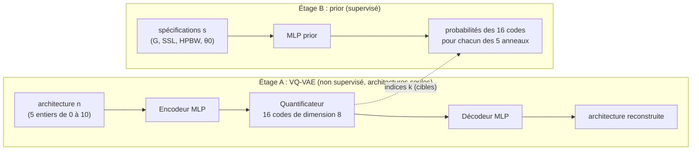
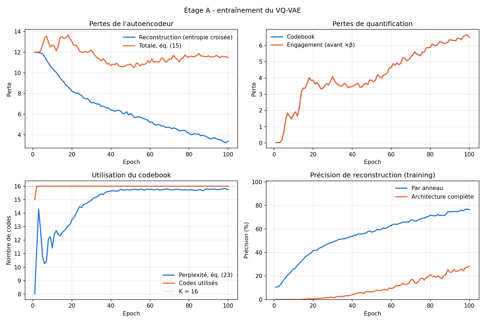
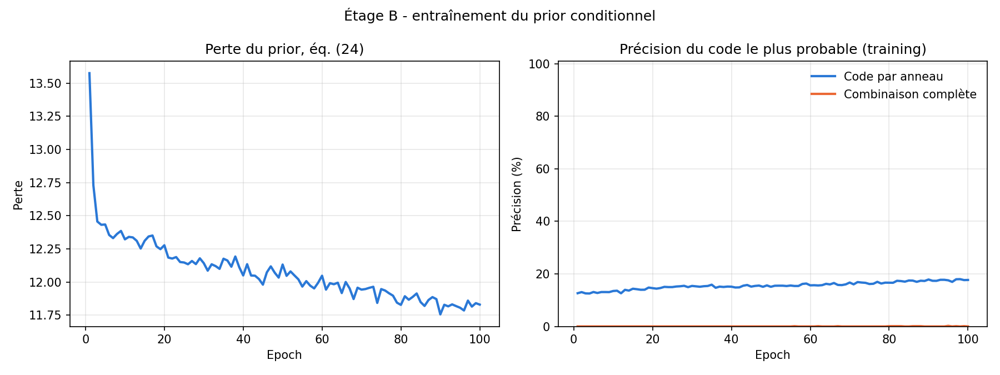

# Script 3 : entraînement du VQ-VAE et du prior (`VQVAE_training.py`)

[← Retour à l'index de la documentation](README.md)

## Pourquoi un VQ-VAE ?

Plusieurs architectures donnent des spécifications voisines (voir [script 1](01_dataset.md)). Un FFNN entraîné par erreur quadratique prédit la **moyenne** de ces solutions. Par exemple, s'il hésite entre 2 et 10 éléments sur un anneau, il propose 6, qui ne correspond à aucune des deux.

Le VQ-VAE fonctionne autrement : il **propose plusieurs architectures candidates**, puis la physique choisit la meilleure (voir [script 4](04_test.md)). L'entraînement se fait en deux étages.



```
python VQVAE_training.py            # 100 + 100 époques, environ 25 s sur CPU
python VQVAE_training.py --rapide   # 2 + 2 époques, pour tester la chaîne
```

Les numéros d'équations renvoient au **rapport de synthèse théorique du groupe**, qui n'est pas inclus dans le dépôt.

## Étage A : le VQ-VAE

### Architecture (57 823 paramètres)

| Bloc | Opération | Forme |
|---|---|---|
| Entrée | n_r codé en one-hot sur 11 classes (n_r ∈ {0,…,10}), aplati | (B, 5, 11) → (B, 55) |
| Encodeur | Linear 55→128, ReLU, Linear 128→128, ReLU, Linear 128→40 | (B, 55) → Z_e (B, 5, 8) : **un vecteur par anneau** |
| Quantificateur | chaque vecteur est remplacé par le plus proche des **K = 16 codes** de dimension D = 8 | indices k (B, 5) et Z_q (B, 5, 8) |
| Décodeur | Linear 40→128, ReLU, Linear 128→128, ReLU, Linear 128→55 | logits (B, 5, 11), puis softmax par anneau |

**11 classes et non 10** comme dans le §4.5 du rapport : chez l'enseignant, n_r peut valoir 0. La capacité reste suffisante, puisque 5·log2(11) ≈ 17,3 bits ≤ 5·log2(16) = 20 bits.

### Les trois mécanismes du VQ-VAE

- **Plus proche voisin** (éq. (6) et (9)) : les distances sont calculées par ‖z‖² − 2zᵀe + ‖e‖², ce qui se ramène à un produit matriciel.
- **Straight-through** (éq. (19)) : `z_q = z_e + (z_q - z_e).detach()`. En passe avant, le décodeur reçoit bien le code. En passe arrière, le gradient traverse la quantification comme si c'était l'identité.
- **Perte** (éq. (15)-(16)), avec β = 0,25 :

$$\mathcal{L} = \underbrace{-\sum_{r=1}^{5}\log p(n_r\mid Z_q)}_{\text{reconstruction}} + \underbrace{\sum_{r=1}^{5}\lVert \mathrm{sg}[z_{e,r}] - e_{k_r}\rVert^2}_{\text{codebook}} + \beta\underbrace{\sum_{r=1}^{5}\lVert z_{e,r} - \mathrm{sg}[e_{k_r}]\rVert^2}_{\text{engagement}}$$

  Chaque terme est **sommé sur les 5 anneaux** puis moyenné sur le lot, comme dans l'éq. (16). Nous avons comparé trois conventions avec les mêmes hyperparamètres :

  | Convention | Écart quadratique z_e − z_q (moyenne par coordonnée, test) | Reconstruction training (anneau / archi) |
  |---|---|---|
  | Code de référence §4.3 (tout moyenné, `F.mse_loss`) | 1,97 | 71,5 % / 18,8 % |
  | Entropie croisée sommée, pertes VQ moyennées | 9,90 | 68,8 % / 15,9 % |
  | **Éq. (16) : tout sommé sur les anneaux (retenue)** | **0,14** | **76,4 % / 28,3 %** |

  Avec les deux autres conventions, l'engagement pèse trop peu : les sorties de l'encodeur s'éloignent des codes et l'approximation straight-through se dégrade.

### Codes morts

Un code jamais choisi ne reçoit aucun gradient et reste figé (rapport §4.4). À la fin de chaque époque, tout code inutilisé sur le training est **réinitialisé sur un z_e tiré au hasard**. En pratique, cela n'arrive qu'aux toutes premières époques ; ensuite, les 16 codes restent utilisés.

### Suivi à chaque époque

Les pertes sont moyennées sur les lots. Les diagnostics sont calculés sur tout le training, en fin d'époque : perplexité du codebook (éq. (23), entre 1 et 16), nombre de codes utilisés, précision de reconstruction par anneau et par architecture complète.

## Étage B : le prior conditionnel (43 984 paramètres)

1. **Figer** l'autoencodeur et encoder les 900 architectures du training en indices k (900 × 5).
2. **Normaliser** les spécifications en min-max (convention FFNN), avec des statistiques calculées **sur le training uniquement**.
3. Entraîner un MLP 4 → 128 → 128 → 128 → 5×16 (ReLU), qui donne pour chaque anneau une distribution sur les 16 codes. Sa perte est la somme sur les anneaux des entropies croisées (éq. (24)) :

$$p(\mathbf{k}\mid \mathbf{s})=\prod_{r=1}^{5}p(k_r\mid \mathbf{s}),\qquad \mathcal{L}_{\text{prior}}=-\sum_{r=1}^{5}\log p(k_r\mid \mathbf{s})$$

Le script calcule aussi les **écarts-types σ** de G, SSL et HPBW sur le training : σ_G = 2,89 dB, σ_SSL = 3,05 dB, σ_HPBW = 24,97°. Ils servent au critère de sélection du [script 4](04_test.md).

## Hyperparamètres

Ils sont tous regroupés en tête du script.

| Paramètre | Valeur | | Paramètre | Valeur |
|---|---|---|---|---|
| K (codes) | 16 | | Optimiseur | Adam |
| D (dimension des codes) | 8 | | Taux d'apprentissage | 1e-3 (les deux étages) |
| β (engagement) | 0,25 | | Taille de lot | 64 |
| Neurones cachés | 128 | | Époques | 100 (étage A) + 100 (étage B) |
| Graine | 46 | | Device | CUDA si disponible, sinon CPU |

## Fichiers produits

| Fichier | Contenu |
|---|---|
| `vqvae_model.pt`, `prior_model.pt` | poids (`state_dict`) ; les classes sont recopiées à l'identique dans le script 4 |
| `normalization_params_VQVAE.npz` / `.mat` | `Minput_min`, `Minput_max` (4 valeurs chacun), `sigma_specs` (σ de G, SSL, HPBW) |
| `historique_VQVAE.npy` / `.mat` | 100 × 9, une ligne par époque : `loss_totale`, `loss_reconstruction`, `loss_codebook`, `loss_engagement`, `perplexite`, `codes_utilises`, `codes_reinitialises`, `precision_par_anneau`, `precision_par_architecture` |
| `historique_prior.npy` / `.mat` | 100 × 3 : `loss_prior`, `precision_code_par_anneau`, `precision_combinaison_complete` |
| `courbes_VQVAE.png`, `courbe_prior.png` | courbes d'entraînement |

Dans les `.mat`, la variable `colonnes` donne le nom des colonnes et `duree_s` la durée de l'étage.

## Valeurs atteintes en fin d'entraînement

| | Valeur finale (training) |
|---|---|
| Reconstruction par anneau / par architecture | 76,4 % / 28,3 % |
| Perplexité du codebook | 15,76 sur 16 (16 codes utilisés) |
| Prior : précision du code le plus probable, par anneau | 17,7 % (le hasard donne 6,25 %) |
| Durée | étage A 13 s, étage B 12 s |





Ces chiffres sont analysés dans la [page des résultats](05_resultats.md).
