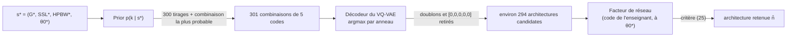

# Script 4 : test et comparaison avec le FFNN (`test_model_VQVAE.py`)

[← Retour à l'index de la documentation](README.md)

## Rôle

Pour chacun des 100 cahiers des charges du test, s* = (G*, SSL*, HPBW*, θ0*), ce script :
- propose une architecture n̂ avec le VQ-VAE ;
- vérifie ses performances avec le code de l'enseignant ;
- compare le résultat au FFNN de l'enseignant, appliqué aux mêmes exemples.

```
python test_model_VQVAE.py      # environ 2 min sur CPU (1 s par spécification)
```

## Conception inverse : comment n̂ est choisie



1. **Tirer** N_CAND = 300 combinaisons de codes selon le prior, plus la combinaison la plus probable (argmax par anneau).
2. **Décoder** chaque combinaison en architecture (argmax par anneau). On retire les doublons et l'architecture vide [0,0,0,0,0].
3. **Évaluer** G, SSL et HPBW de chaque candidat avec la fonction de l'enseignant, **à l'angle θ0\* demandé**.
4. **Retenir** le candidat le plus proche du cahier des charges, selon l'éq. (25) du rapport :

$$\hat{\mathbf{n}}=\arg\min_i\;\left(w_1\frac{|G^{(i)}-G^*|}{\sigma_G}+w_2\frac{|\mathrm{SSL}^{(i)}-\mathrm{SSL}^*|}{\sigma_{\mathrm{SSL}}}+w_3\frac{|\mathrm{HPBW}^{(i)}-\mathrm{HPBW}^*|}{\sigma_{\mathrm{HPBW}}}\right)$$

Ici w = (1, 1, 1), et σ vient du training (fichier `normalization_params_VQVAE.npz`). Diviser par σ permet de comparer des dB et des degrés sur une même échelle.

θ0 n'entre pas dans le critère : c'est une **condition** du cahier des charges. Il est donné au prior et sert à calculer le diagramme des candidats.

## Évaluation

### Erreur de prédiction de l'enseignant

Les lignes de calcul sont **copiées telles quelles** depuis `test_model_FFNN.py` (lignes 263-265 et 274-298), et seulement placées dans une fonction pour être appliquées aux 100 exemples. La référence est recalculée à partir de l'architecture de test, comme chez l'enseignant ; elle est identique à `Minput_test` (écart 0).

$$e_G=100\,\frac{|G_{\text{pred}}-G_{\text{ref}}|}{\max G},\quad e_{\mathrm{SSL}}=100\,\frac{|\mathrm{SSL}_{\text{pred}}-\mathrm{SSL}_{\text{ref}}|}{\max|\mathrm{SSL}|},\quad e_{\mathrm{HPBW}}=100\,\frac{|\mathrm{HPBW}_{\text{pred}}-\mathrm{HPBW}_{\text{ref}}|}{180}$$

$$\text{erreur globale}=0{,}33\,e_G+0{,}33\,e_{\mathrm{SSL}}+0{,}34\,e_{\mathrm{HPBW}}\quad(\%)$$

Les maxima sont pris sur tout `Minput` : max G = 33,44 dB et max |SSL| = 38,69 dB. Le script calcule aussi la **MAE** de chaque spécification, en dB et en degrés, car l'erreur relative est peu parlante pour des grandeurs en dB.

### Diagnostics du VQ-VAE sur le test

- Précision de reconstruction par anneau et par architecture.
- Perplexité du codebook.
- Perte et précision du prior.
- Nombre moyen de candidats uniques.
- Part des cas où l'architecture de référence figure parmi les candidats.

### Comparaison avec le FFNN

Si `ffnn_model.pth` et `normalization_params.npz` (fichiers de l'enseignant) sont présents, le script applique le FFNN aux 100 exemples. Il reprend la classe et les lignes de prédiction de `test_model_FFNN.py` : normalisation min-max, passage dans le réseau, dénormalisation, arrondi. Il évalue ensuite le FFNN avec la même erreur. S'ils sont absents, la comparaison est simplement sautée.

## Fichiers produits

La convention de l'enseignant est conservée pour les matrices : une colonne = un exemple de test.

| Fichier | Forme | Contenu |
|---|---|---|
| `Moutput_pred_VQVAE.npy` | 5 × 100 | architectures proposées par le VQ-VAE |
| `Minput_obtenu_VQVAE.npy` | 4 × 100 | spécifications obtenues [G, SSL, HPBW, θ0] |
| `erreurs_VQVAE.npy` | 100 × 7 | par exemple : `MAE_G_dB`, `MAE_SSL_dB`, `MAE_HPBW_deg`, `err_rel_G_pct`, `err_rel_SSL_pct`, `err_rel_HPBW_pct`, `erreur_globale_pct` |
| `predictions_VQVAE.mat` | | les trois matrices ci-dessus, plus `nb_candidats_uniques`, `score_critere` (valeur de l'éq. (25)), `reference_parmi_candidats` |
| `metriques_VQVAE.npy` / `.mat` | 18 valeurs | métriques agrégées ; leurs noms sont dans `noms_metriques` du `.mat` |
| `Moutput_pred_FFNN.npy`, `Minput_obtenu_FFNN.npy`, `erreurs_FFNN.npy` | | mêmes formats, pour le FFNN |
| `comparaison_VQVAE_FFNN.npy` / `.mat` | 10 × 2 | tableau comparatif : `tableau`, avec `lignes` = métriques et `colonnes` = VQVAE, FFNN |
| `diagramme_exemple_00/10/42/77.png` | | diagrammes demandé, VQ-VAE et FFNN, en polaire et en cartésien (l'exemple 10 est celui du script de l'enseignant) |
| `distribution_erreurs.png` | | distribution de l'erreur globale et erreur relative moyenne par spécification |

## Réglages

Les réglages sont en tête du script : `N_CAND = 300`, `POIDS_CRITERE = [1, 1, 1]`, `INDICES_FIGURES = [0, 10, 42, 77]`, et `AFFICHER_FIGURES = False`. Avec `False`, les figures sont seulement enregistrées en `.png` ; avec `True`, elles s'ouvrent aussi dans des fenêtres, ce qui bloque le script jusqu'à leur fermeture.

**Coût** : environ 294 évaluations du facteur de réseau par spécification, soit 29 424 au total pour 105 s. Le FFNN n'en fait qu'une par spécification.
