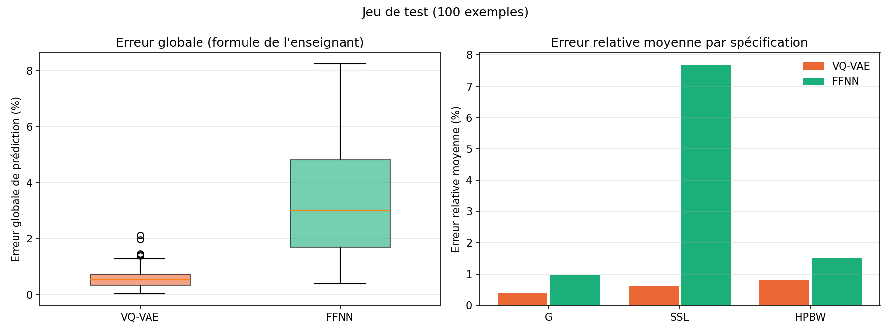
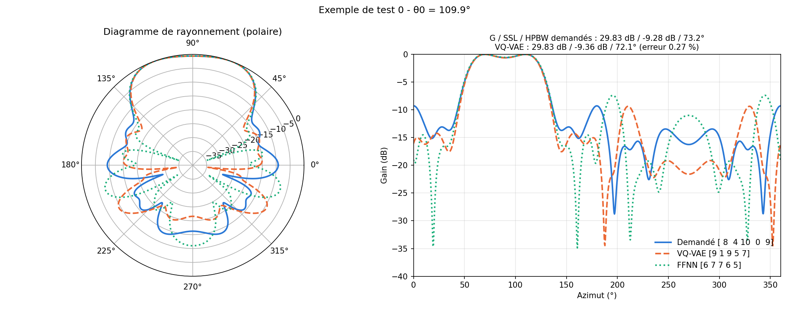
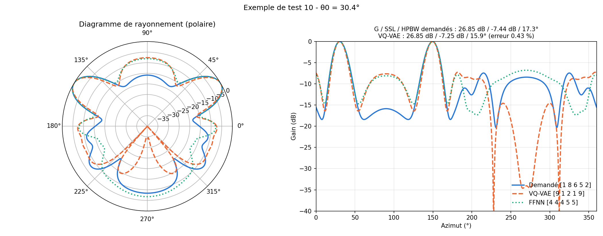
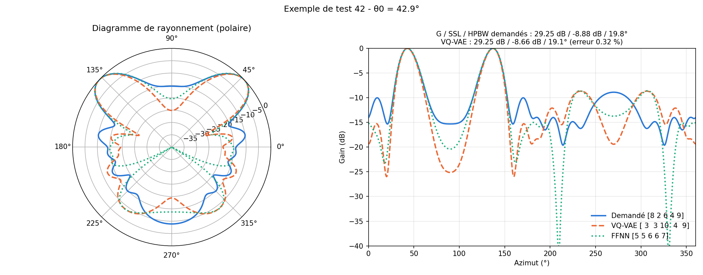
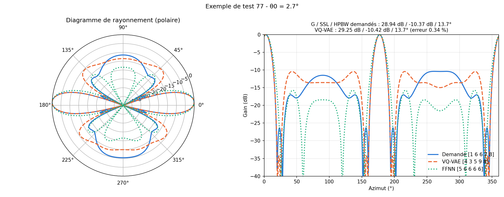

# Résultats et limites

[← Retour à l'index de la documentation](README.md)

Les chiffres de cette page viennent de la configuration complète : 100 exemples de test inédits, communs au VQ-VAE et au FFNN de l'enseignant.

## Comparaison VQ-VAE / FFNN

| Métrique | VQ-VAE | FFNN |
|---|---|---|
| **Erreur globale moyenne** (formule de l'enseignant, %) | **0,61** | 3,37 |
| Erreur globale médiane (%) | 0,54 | 2,99 |
| 90e centile de l'erreur globale (%) | 1,10 | 6,67 |
| Pire exemple (%) | 2,13 | 8,23 |
| MAE G (dB) | 0,13 | 0,33 |
| MAE SSL (dB) | 0,24 | 2,98 |
| MAE HPBW (°) | 1,49 | 2,70 |
| Temps d'inférence par exemple (s) | 1,04 | 0,003 |

- Le VQ-VAE fait mieux que le FFNN sur **96 exemples sur 100**.
- Le gain est le plus net sur le **SSL** (MAE divisée par 12).
- Le FFNN, entraîné par erreur quadratique, prédit des architectures « moyennes ». 74 % de ses valeurs sont entre 4 et 7 éléments, et leur écart-type par anneau n'est que d'environ 1,6, contre 3,1 pour les architectures de référence. Son gain est correct, mais son niveau de lobe secondaire est mal maîtrisé.
- Les architectures du VQ-VAE ont la même dispersion que les références (écart-type d'environ 3,2).
- Aucun des deux modèles ne retrouve l'architecture de référence exacte, et ce n'est pas un défaut : le problème a de nombreuses solutions, et seules les spécifications obtenues comptent.

## Exemples tracés

| Exemple | θ0 | Référence | VQ-VAE | Erreur VQ-VAE | FFNN | Erreur FFNN |
|---|---|---|---|---|---|---|
| 0 | 109,9° | [8 4 10 0 9] | [9 1 9 5 7] | 0,27 % | [6 7 7 6 5] | 1,76 % |
| 10 | 30,4° | [1 8 6 5 2] | [9 1 2 1 9] | 0,43 % | [4 4 4 5 5] | 0,57 % |
| 42 | 42,9° | [8 2 6 4 9] | [3 3 10 4 9] | 0,32 % | [5 5 6 6 7] | 0,39 % |
| 77 | 2,7° | [1 6 6 7 8] | [4 3 5 9 8] | 0,34 % | [5 6 6 6 6] | 5,13 % |

Pour l'exemple 0, la référence et le VQ-VAE ont toutes deux 31 éléments, donc le même G = 29,83 dB, avec des répartitions très différentes. C'est une illustration directe de la non-unicité. Pour l'exemple 77, le FFNN obtient un SSL de −15,7 dB au lieu des −10,4 dB demandés.

## Diagnostics du VQ-VAE

| | Training | Test |
|---|---|---|
| Reconstruction par anneau | 76,4 % | 49,2 % |
| Reconstruction par architecture complète | 28,3 % | 3,0 % |
| Perplexité du codebook (sur 16) | 15,76 | 15,15 |
| Prior : précision du code le plus probable, par anneau | 17,7 % | 11,8 % (le hasard donne 6,25 %) |
| Candidats uniques par spécification | | 294 en moyenne (min 269, max 301) |

Le codebook est bien exploité : 16 codes utilisés, et une perplexité proche du maximum de 16.

## Limites : à lire avant de conclure

1. **Le gain vient surtout de la vérification physique.** Une recherche **aléatoire** de 301 architectures, notée avec le même critère (25), atteint déjà **0,72 %** d'erreur. Le prior appris n'apporte donc qu'environ 15 % d'erreur en moins par rapport au hasard. La comparaison avec le FFNN n'est pas « à coût égal » : le VQ-VAE évalue environ 300 fois le facteur de réseau par spécification, le FFNN une seule. Le rapport l'anticipait au §4.5 : « l'avantage du VQ-VAE n'est pas garanti ». *(Mesure faite hors des quatre scripts.)*
2. **La reconstruction généralise mal.** L'étage A ne voit que 900 architectures sur 161 050 possibles. Il reconstruit 49 % des anneaux du test, mais seulement 3 % des architectures complètes. L'architecture de référence n'apparaît dans aucun des ensembles de candidats.
3. **Le prior suppose les anneaux indépendants** sachant s (éq. (24)). Il peut donc combiner des anneaux qui viennent de solutions différentes ; seule l'étape de vérification compense.

## Pistes d'amélioration

| Piste | Effet mesuré ou attendu |
|---|---|
| Entraîner l'étage A sur **des architectures tirées au hasard en plus** des 900 du training. L'étage A n'a pas besoin des spécifications, donc ces architectures ne coûtent aucun calcul. | Avec 20 000 architectures de plus (hors test), la reconstruction sur le test passe de 49 % à **82 %** par anneau, et de 3 % à **33 %** par architecture. *(Mesure hors scripts.)* |
| Ajouter la recherche aléatoire comme 3e colonne du tableau comparatif | Montre directement ce que le prior apporte. |
| Prior **autorégressif** sur les anneaux : chaque code est prédit à partir de s **et** des codes des anneaux précédents | Lève l'hypothèse d'indépendance (rapport §4.5) ; coût faible avec 5 anneaux. |
| Plus de données étiquetées pour le prior | Le prior n'a que 900 exemples ; c'est lui qui limite l'apport du modèle. |
