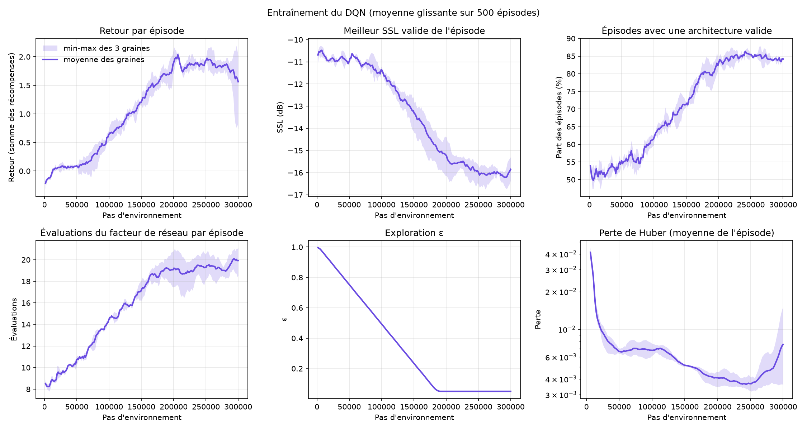
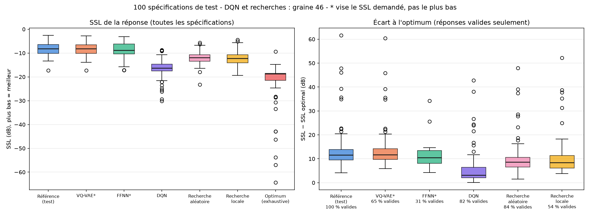
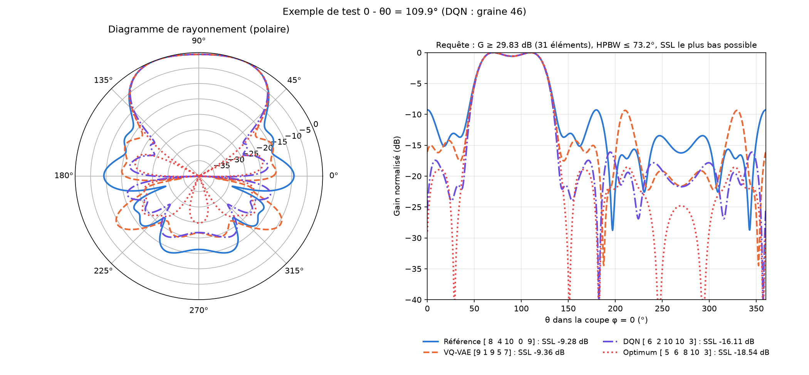
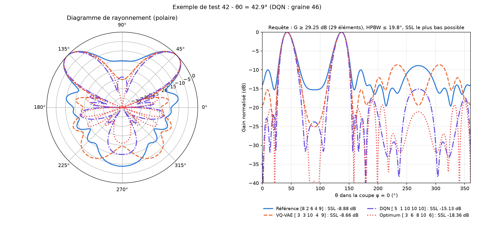
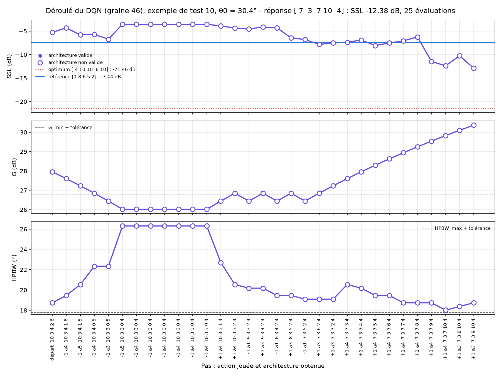

# Second TP : un DQN pour minimiser le niveau des lobes secondaires

[← README principal](../README.md) · [Documentation du premier TP (VQ-VAE)](../docs/README.md)

## La consigne

> « Objectif : optimiser le nombre et l'emplacement des antennes pour minimiser le SSL (side-lobe level). Autre modèle IA basé sur l'apprentissage par renforcement (score → récompense / pénalité). Candidats : PPO, PG, Q-learning, DQN. Choix : DQN (Deep Q-Network). Sans dataset et sans répartition training/test. »
>
> Consigne de N. ISMAIL, transcrite des notes de cours.

Le réseau est celui du premier TP : 5 anneaux concentriques de rayons 0,2 à 2,2 λ, de 0 à 10 éléments par anneau, à 2,45 GHz. La physique est la même : la fonction `calcul_AF_performance_metrics` de l'enseignant, copiée sans modification.

## En bref

- Un agent DQN, écrit avec PyTorch, modifie l'architecture **un élément à la fois** (+1 ou −1 sur un anneau) pour baisser le SSL, sous deux contraintes : un gain minimal (donc un nombre minimal d'antennes) et une ouverture maximale. Il est entraîné **sans dataset** : requêtes et architectures sont tirées à la volée.
- Sur les **100 spécifications de test** du premier TP, avec **20,5 évaluations du facteur de réseau** par spécification en moyenne :

| | DQN (3 graines) | Recherche aléatoire, même budget | Optimum (recherche exhaustive) |
|---|---|---|---|
| Réponses valides | **86 %** (82 à 92 %) | 83 % | 100 % |
| Écart moyen à l'optimum (réponses valides) | **6,9 dB** (6,0 à 8,7 dB) | 10,2 dB | 0 |
| Évaluations du facteur de réseau | 20,5 | 20,5 | 161 050 |

- **L'optimum est calculable ici** : les 161 050 architectures en 0,38 s par spécification sur GPU. Le DQN est donc une **démonstration de méthode**, et l'écart à l'optimum est la mesure honnête.

## Le problème

Une **requête** donne trois nombres : la direction de pointage θ0, un gain minimal G_min et une ouverture maximale HPBW_max. On cherche l'architecture n = [n1, …, n5] (entiers de 0 à 10, au moins un élément) qui a le **SSL le plus bas** tout en respectant les deux contraintes :

```math
\min_{\mathbf{n}}\ \mathrm{SSL}(\mathbf{n};\theta_0)\quad\text{tel que}\quad G(\mathbf{n})\ \ge\ G_{\min}-0{,}05\ \mathrm{dB},\qquad \mathrm{HPBW}(\mathbf{n};\theta_0)\ \le\ \mathrm{HPBW}_{\max}+0{,}5^\circ
```

- **Le « nombre ».** G = 20·log10(Σ n_r), à 0,0007 dB près (voir le [premier TP](../docs/01_dataset.md)). G_min impose donc un **nombre minimal d'antennes**. Deux nombres d'éléments voisins diffèrent d'au moins 20·log10(50/49) = 0,175 dB : avec une tolérance de 0,05 dB, « G ≥ G_min » veut dire exactement « au moins autant d'éléments que demandé ».
- **L'« emplacement ».** La répartition des éléments sur les anneaux fixe le SSL et le HPBW.
- **La tolérance sur le HPBW**, 0,5°, vaut environ un pas de la grille angulaire de l'enseignant (360/999 = 0,36°).
- **Pourquoi des contraintes ?** Sans elles, l'architecture de SSL minimal est souvent petite, avec un faisceau très large. Recherche exhaustive sans contrainte (`physique_antenne.py`, valeurs recalculées par la fonction de l'enseignant) :

| θ0 | Architecture de SSL minimal | Éléments | SSL | HPBW |
|---|---|---|---|---|
| 5° | [9 9 8 10 2] | 38 | −48,4 dB | 17,3° |
| 30° | [7 6 0 0 0] | 13 | −58,9 dB | 54,1° |
| 60° | [10 10 5 1 0] | 26 | −19,7 dB | 101,6° |
| 85° | [8 0 0 0 0] | 8 | −25,6 dB | 168,7° |
| 90° | [8 0 0 0 0] | 8 | −25,2 dB | 168,3° |

> **À savoir sur la physique de l'enseignant.** Avec φ = φ0 = 0, la phase de l'élément n de l'anneau r vaut k·a_r·cos φ_n·(sin θ − sin θ0) : θ0 n'agit que par **sin θ0**. θ0 et 180° − θ0 donnent le même diagramme, donc les mêmes G, SSL et HPBW (vérifié sur 500 architectures : écart maximal 1,8·10⁻¹⁴ dB). Le diagramme a toujours **deux lobes principaux**, en θ0 et en 180° − θ0 ; la règle de l'enseignant (pics à moins de 1 dB du maximum) les compte tous les deux comme lobes principaux. Un diagramme sans aucun pic à plus de 1 dB sous le maximum reçoit SSL = 0 dB. Le SSL est lu sur le diagramme non écrêté : il peut descendre sous −40 dB. Ces conventions sont gardées telles quelles.

## Pourquoi un DQN ?

| Candidat | Ce qu'il apprend | Ici |
|---|---|---|
| **Q-learning** (tabulaire) | une table Q(s, a) | Impossible sans discrétiser grossièrement : l'état contient θ0, G_min et HPBW_max (continus) et l'architecture courante (161 050 possibilités). |
| **DQN** (retenu) | Q(s, a) approchée par un réseau de neurones | Actions **discrètes** (11 coups) ; état continu ; **hors politique**, avec une mémoire de rejeu : chaque évaluation du facteur de réseau sert à plusieurs mises à jour. |
| **PG** (REINFORCE) | directement une politique π(a \| s) | Possible (actions discrètes), mais sur politique : chaque transition ne sert qu'une fois, et la variance du gradient est forte. |
| **PPO** | une politique, avec des pas « prudents » | Possible et souvent robuste, mais toujours sur politique ; une alternative à comparer. |

## La physique : fonction de l'enseignant et version rapide

`physique_antenne.py` contient la fonction de l'enseignant **copiée telle quelle** (même copie que `dataset.py`, comparée ligne à ligne à chaque exécution), et une version rapide :

- le facteur de réseau est une somme de contributions par anneau, qui ne dépendent que de (anneau, N_r, θ0). Pour un θ0, on calcule les 5 × 11 diagrammes d'anneau avec la même expression de phase, puis chaque architecture est une somme de 5 diagrammes ;
- G, SSL et HPBW sont ensuite calculés avec les lignes de l'enseignant (une architecture), ou avec les mêmes règles vectorisées sur GPU (un lot), avec un repli exact sur `find_peaks` dans les cas limites (plateau, ou deux pics à moins de 5 points).

`python rl_dqn/physique_antenne.py` compare les deux versions à la fonction de l'enseignant sur **2000 couples (architecture, θ0) aléatoires** :

| | Écart maximal G | Écart maximal SSL | Écart maximal HPBW | Couples avec un écart > 10⁻⁹ |
|---|---|---|---|---|
| Version rapide (une architecture) | 1,1·10⁻¹⁴ dB | 5,0·10⁻¹⁴ dB | 0 | 0 |
| Calcul par lot (GPU) | 1,1·10⁻¹⁴ dB | 5,7·10⁻¹⁴ dB | 0 | 0 (8 replis exacts) |

Temps mesurés pendant cette vérification : 0,86 ms par architecture pour la fonction de l'enseignant, 0,19 ms pour la version rapide (plus 5,3 ms par θ0 pour les diagrammes d'anneau), et **0,40 s** pour les 161 050 architectures d'un θ0 sur GPU (environ 138 s estimées avec la fonction de l'enseignant). Toutes les réponses finales du script R2 sont **recalculées avec la fonction de l'enseignant**.

## L'environnement (`env_antenne.py`)

Une interface minimale à la Gym : `reset()` donne l'état initial, `step(action)` donne l'état suivant, la récompense et la fin d'épisode.

- **Requête d'entraînement**, tirée à la volée : θ0 ~ U[0°, 180°] ; G_min et HPBW_max uniformes dans les plages atteintes, **à ce θ0**, par 64 architectures aléatoires (même loi que `dataset.py`). **Aucun fichier n'est lu.** Les deux contraintes sont tirées indépendamment : une requête peut être impossible à satisfaire, l'agent ne reçoit alors que des pénalités. Les requêtes de test, elles, ont toujours une solution (l'architecture de référence).
- **Départ** : une architecture aléatoire (même loi).
- **11 actions** : +1 élément sur l'anneau r (5 actions), −1 élément sur l'anneau r (5 actions), arrêt. Un coup illégal (n_r < 0, n_r > 10, réseau vide) ne change rien et coûte 0,1.
- **Fin** : arrêt, ou 30 pas.
- **Réponse** : la meilleure architecture **valide** vue pendant l'épisode (SSL minimal) ; s'il n'y en a aucune, celle de meilleur score J, comptée comme non valide.
- **État** (14 valeurs) : n/10 (5 valeurs), sin θ0, G_min/34, HPBW_max/180, G/34, SSL/40, HPBW/180, déficit de gain/10, excès de HPBW/90, pas restants/30.

**Score et récompense** (« score → récompense / pénalité ») :

```math
J(\mathbf{n})=-\mathrm{SSL}(\mathbf{n})-\alpha\,\max\big(0,\,G_{\min}-0{,}05-G(\mathbf{n})\big)-\beta\,\max\big(0,\,\mathrm{HPBW}(\mathbf{n})-\mathrm{HPBW}_{\max}-0{,}5\big)-P\cdot\mathbb{1}[\mathbf{n}\ \text{non valide}]
```

```math
r_t=\frac{J(\mathbf{n}_{t+1})-J(\mathbf{n}_t)}{10}-0{,}005\ \ (\text{coup légal}),\qquad r_t=-0{,}1\ \ (\text{coup illégal}),\qquad r_t=0\ \ (\text{arrêt})
```

| Terme | Valeur | Justification |
|---|---|---|
| α | 10 par dB de gain manquant | un élément manquant coûte 8,7·α/N ≥ 1,7 dB de score (N ≤ 50) |
| β | 1 par degré de HPBW en trop | 1° de trop coûte 1 dB de score |
| P | 5 dB si l'architecture n'est pas valide | voir ci-dessous |
| ÷ 10 | | récompenses de l'ordre de l'unité |
| 0,005 par pas | 0,05 dB de score | s'arrêter a un sens, et le nombre d'évaluations compte |

**Le terme P a été ajouté après des essais** (1 graine, 100 000 pas, évalués sur les 100 spécifications de test). Sans lui, l'agent acceptait de petites violations des contraintes en échange de quelques dB de SSL : 59 % de réponses valides seulement, contre 85 % pour la recherche aléatoire au même budget. Avec P = 20 dB, il s'arrêtait dès la première architecture valide : 94 % de réponses valides, mais pas meilleur que la recherche aléatoire (écart moyen à l'optimum 10,3 dB contre 10,2 dB). P = 5 dB donnait 85 % de réponses valides et 8,1 dB d'écart moyen. Ces essais ne sont pas dans les scripts ; voir [Étiquetage honnête](#étiquetage-honnête).

La récompense ΔJ s'additionne sur l'épisode : le retour vaut J(final) − J(départ). L'agent est donc récompensé pour l'architecture où il s'arrête ; la réponse retenue est la meilleure architecture valide vue, qui ne peut être que meilleure ou égale.

## Le DQN (`DQN_training.py`, script R1)

Écrit avec PyTorch, sans bibliothèque d'apprentissage par renforcement.

| Élément | Valeur |
|---|---|
| Réseau Q | MLP 14 → 256 → 256 → 11, ReLU (72 459 paramètres) |
| Cible | Double DQN : y = r + γ·(1 − fin)·Q_cible(s′, argmax_a Q(s′, a)), γ = 0,99 |
| Perte | Huber ; Adam, taux 5·10⁻⁴ ; norme du gradient écrêtée à 10 |
| Mémoire de rejeu | 100 000 transitions ; lots de 512, une mise à jour toutes les 4 transitions |
| Réseau cible | copié toutes les 500 mises à jour |
| Exploration | ε-greedy, ε de 1 à 0,05 sur les 60 premiers % des pas |
| Entraînement | 300 000 pas par graine, graines 46, 47 et 48 ; `--rapide` : 1 graine, 3 000 pas |
| Device | GPU si disponible (run committé : GPU) |

Lots de 512 toutes les 4 transitions : sur notre GPU, une mise à jour coûte le même temps avec 512 ou 128 exemples (environ 1,4 ms, surtout du temps de lancement). On rejoue autant d'exemples par pas qu'avec des lots de 128 à chaque pas, avec 4 fois moins de mises à jour.

**Entraînement committé** : 51 323 épisodes en 1 238 s (388, 410 et 436 s selon la graine). Sur les 500 derniers épisodes de chaque graine, l'agent trouve une architecture valide dans 84,4 %, 83,6 % et 84,6 % des épisodes, avec 20,2, 21,1 et 18,5 évaluations par épisode.



La part d'épisodes valides passe d'environ 50 % à 85 %, et le meilleur SSL valide de −10,5 dB à environ −16 dB. En fin d'entraînement, une graine (47) se dégrade : entre 200 000 et 250 000 pas puis après 275 000 pas, son retour moyen passe de 1,88 à 1,21 et sa perte de 0,0036 à 0,0114 (enveloppe claire) ; les deux autres restent stables. Aucun arrêt précoce ni choix du meilleur modèle n'est fait : c'est le réseau de la fin d'entraînement qui est évalué.

## Évaluation (`test_model_DQN.py`, script R2)

Les 100 spécifications de test du premier TP (split du FFNN de l'enseignant) ne sont lues **que** par ce script. Requête n° i : θ0 = θ0 de test, G_min = G de test, HPBW_max = HPBW de test. L'architecture de référence du test respecte ces contraintes par construction.

| Méthode | Comment |
|---|---|
| Référence, VQ-VAE, FFNN | architectures lues dans `Moutput_test.npy`, `Moutput_pred_VQVAE.npy` et `Moutput_pred_FFNN.npy` (modèles non relancés), notées avec la fonction de l'enseignant |
| DQN | déroulé glouton (argmax Q) depuis un départ aléatoire tiré avec la graine 46, le même pour les 3 graines du DQN et pour la recherche locale |
| Recherche aléatoire | autant d'architectures aléatoires distinctes que d'évaluations utilisées par le DQN de la même graine sur cette spécification |
| Recherche locale | mêmes coups ±1 que le DQN, même départ, même budget ; un voisin non évalué tiré au hasard est gardé s'il améliore J ; nouveau départ aléatoire dans un optimum local |
| Optimum | recherche exhaustive sur les 161 050 architectures (GPU) |

> **Le VQ-VAE et le FFNN visent le SSL *demandé*** (et le G demandé), **pas le SSL le plus bas.** Leurs lignes comparent des objectifs différents, pas la qualité des modèles. Ils sont là pour situer les niveaux de SSL.

## Résultats

Run committé : 100 spécifications de test, 3 graines (moyenne ± écart-type entre graines). SSL, G et HPBW recalculés par la fonction de l'enseignant. L'écart à l'optimum (SSL − SSL optimal) n'est calculé que sur les réponses valides.

| Méthode | SSL moyen | SSL médian | Réponses valides | Écart moyen à l'optimum | Écart médian | Évaluations du facteur de réseau | Temps par spécification |
|---|---|---|---|---|---|---|---|
| Référence (test) | −8,30 dB | −8,15 dB | 100 % | 13,37 dB | 11,59 dB | — | — |
| VQ-VAE* | −8,32 dB | −8,16 dB | 65 % | 14,38 dB | 11,71 dB | 294,2 | 1,04 s |
| FFNN (enseignant)* | −8,71 dB | −8,88 dB | 31 % | 11,63 dB | 10,51 dB | 1 | 0,0035 s |
| **DQN** | **−15,22 ± 1,42 dB** | −15,22 dB | **86,0 ± 4,3 %** | **6,90 ± 1,28 dB** | 4,48 dB | 20,5 | 0,012 s |
| Recherche aléatoire | −12,15 ± 0,05 dB | −11,86 dB | 83,0 ± 2,9 % | 10,24 ± 0,20 dB | 8,07 dB | 20,5 | 0,009 s |
| Recherche locale | −12,40 ± 0,11 dB | −12,14 dB | 54,7 ± 2,5 % | 10,99 ± 0,48 dB | 8,10 dB | 20,5 | 0,009 s |
| Optimum (exhaustive) | −21,66 dB | −18,76 dB | 100 % | 0 | 0 | 161 050 | 0,38 s |

\* Visent le SSL demandé, pas le plus bas. Coûts tirés du run committé du premier TP (294,2 = nombre moyen de candidats uniques). Le SSL moyen compte aussi les réponses non valides. Les écarts médians sont la moyenne des médianes des 3 graines.

**Par graine** :

| Graine | DQN valides | DQN écart moyen (médian) | Aléatoire valides | Aléatoire écart moyen | Spécifications où le DQN bat la recherche aléatoire (les deux valides) |
|---|---|---|---|---|---|
| 46 | 82 % | 5,97 dB (3,16) | 84 % | 10,27 dB | 64 sur 73 |
| 47 | 84 % | 8,72 dB (6,40) | 86 % | 9,98 dB | 46 sur 73 |
| 48 | 92 % | 6,02 dB (3,87) | 79 % | 10,46 dB | 70 sur 77 |

Ce qu'il faut en retenir :

- **Au même budget d'évaluations, le DQN trouve des SSL plus bas que les deux recherches** : environ 3 dB de moins d'écart moyen à l'optimum que la recherche aléatoire, pour une part de réponses valides voisine en moyenne (86 % contre 83 %), mais un peu plus faible pour 2 graines sur 3 (82 contre 84 %, 84 contre 86 %). La recherche locale aléatoire, avec les mêmes coups, fait moins bien que la recherche aléatoire : c'est la politique apprise qui apporte le gain, pas les coups ±1 eux-mêmes.
- **La dispersion entre graines est forte** : écart moyen de 6,0 à 8,7 dB, réponses valides de 82 à 92 %. La graine 47 ne bat la recherche aléatoire que sur 46 spécifications sur 73.
- **Le DQN reste loin de l'optimum** : 6,9 dB en moyenne, et il ne trouve l'architecture optimale (à 10⁻⁹ dB près) que dans 1,3 % des cas. 14 % de ses réponses ne sont pas valides.
- **Le « nombre » d'antennes** : l'optimum utilise **plus** d'éléments que le minimum imposé par G_min dans 96 % des spécifications (10,4 de plus en moyenne). Baisser le SSL demande ici d'ajouter des antennes ; c'est la contrainte d'ouverture qui limite. Le DQN l'a appris en partie : 7,8, 6,6 et 11,1 éléments de plus que le minimum selon la graine.
- **L'optimum est bien plus bas que la référence** : 13,4 dB en moyenne. Parmi les 161 050 architectures, une spécification en admet en médiane 32 590 de valides.

### Figures



À gauche, le SSL des réponses ; à droite, l'écart à l'optimum des réponses valides (graine 46). Les valeurs très basses de l'optimum (jusqu'à −64,4 dB, à θ0 = 2,2°) viennent du SSL lu sur le diagramme non écrêté.

| Exemple | θ0 | Référence | VQ-VAE | DQN (graine 46) | Optimum |
|---|---|---|---|---|---|
| 0 | 109,9° | [8 4 10 0 9] −9,28 dB | [9 1 9 5 7] −9,36 dB | [6 2 10 10 3] **−16,11 dB** | [5 6 8 10 3] −18,54 dB |
| 10 | 30,4° | [1 8 6 5 2] −7,44 dB | [9 1 2 1 9] −7,25 dB | [7 3 7 10 4] −12,38 dB, **non valide** (HPBW 18,0° > 17,8°) | [4 10 10 8 10] −21,46 dB |
| 42 | 42,9° | [8 2 6 4 9] −8,88 dB | [3 3 10 4 9] −8,66 dB | [5 1 10 10 10] **−15,13 dB** | [3 6 8 10 6] −18,36 dB |
| 77 | 2,7° | [1 6 6 7 8] −10,37 dB | [4 3 5 9 8] −10,42 dB | [5 9 6 2 6] −23,59 dB, **non valide** (HPBW 15,9° > 14,2°) | [2 5 10 7 9] −24,03 dB |




Les diagrammes des exemples 10 et 77 sont dans [`diagrammes_DQN_10.png`](diagrammes_DQN_10.png) et [`diagrammes_DQN_77.png`](diagrammes_DQN_77.png).

**Le déroulé pas à pas** est tracé sur l'exemple 10, celui de l'enseignant, choisi avant le run. C'est un **échec** de la graine 46, instructif : l'agent part de [10 3 4 2 6], retire des éléments, puis joue **6 fois de suite le coup illégal** « −1 sur l'anneau 4 » alors que cet anneau est vide (la politique gloutonne est déterministe et l'état ne change presque pas). Il ajoute ensuite des éléments et finit à 18,0° d'ouverture, 0,2° au-dessus de la limite tolérée : aucune architecture valide vue en 25 évaluations.



## Lancer les scripts

Windows 11, PowerShell, Python 3.12.15, depuis la racine du dépôt :

```powershell
python rl_dqn/physique_antenne.py     # vérification de la physique (30 s)
python rl_dqn/DQN_training.py         # R1 : 3 graines × 300 000 pas (21 min sur notre GPU)
python rl_dqn/test_model_DQN.py       # R2 : 100 spécifications de test (50 s)
```

Avec `--rapide` (200 couples, 1 graine × 3 000 pas, 5 spécifications), les trois scripts tournent en 22 s au total sur notre machine. Les chiffres n'ont alors aucun sens : cela montre seulement que la chaîne fonctionne. Chaque script écrit dans `rl_dqn/` et écrase les résultats committés ; `git restore rl_dqn` les remet.

Machine du run committé : CPU Intel Core i7-13650HX, GPU NVIDIA GeForce RTX 5050 Laptop. Versions : numpy 2.5.5, scipy 1.18.1, matplotlib 3.11.2, torch 2.14.1+cu130. Sans GPU, tout tourne sur CPU (plus lentement), et les tirages diffèrent.

## Étiquetage honnête

| Ce que vous voyez | Ce que c'est vraiment |
|---|---|
| Chaque G, SSL et HPBW | **Calculés, pas mesurés** : facteur de réseau de sources ponctuelles idéales, coupe φ = 0, fonction de l'enseignant. Aucune antenne construite ni mesurée. |
| « Sans dataset » | L'agent ne lit aucun fichier : requêtes et architectures sont tirées à la volée. Les 100 spécifications de test ne sont lues que par R2, pour l'évaluation finale. |
| L'optimum | Une recherche exhaustive, possible ici (0,38 s par spécification sur GPU). Le RL n'est donc pas nécessaire pour ce problème : c'est une démonstration de méthode, et **l'écart à l'optimum** est la mesure honnête. |
| Le terme P = 5 dB | **Choisi après trois essais évalués sur les 100 spécifications de test** (P = 0, 5 et 20 dB ; 1 graine, 100 000 pas). Ce réglage a donc vu le test. Les essais ne sont pas dans les scripts ; leurs chiffres sont dans la section Environnement. |
| 86 % et 6,9 dB | Moyenne de 3 graines ; la dispersion entre graines est forte (82 à 92 %, 6,0 à 8,7 dB). |
| Requêtes d'entraînement et de test | Lois différentes : à l'entraînement, G_min et HPBW_max sont tirés indépendamment dans des plages ; au test, ce sont le G et le HPBW d'une même architecture réelle. |
| VQ-VAE et FFNN | Architectures lues dans les fichiers du premier TP, non relancées. Elles visent le SSL demandé, pas le plus bas. |
| Temps | Mesurés sur notre machine (voir ci-dessus) ; ceux du VQ-VAE et du FFNN viennent du run committé du premier TP, dont la machine n'est pas connue. |

## Limites

- **Le RL n'est pas nécessaire ici** : la recherche exhaustive donne l'optimum en 0,38 s par spécification. Le DQN reste à 6,9 dB de l'optimum en moyenne, avec environ 20 évaluations au lieu de 161 050.
- **14 % des réponses du DQN ne sont pas valides**, souvent à cause d'une contrainte d'ouverture serrée (exemples 10 et 77).
- **La politique gloutonne répète les coups illégaux** (6 pas sur 30 sur l'exemple 10). Masquer les coups illégaux dans l'argmax supprimerait ce gaspillage.
- **La fin d'entraînement est instable pour une graine** (47), et le réseau évalué est celui du dernier pas, sans sélection.
- **Le terme P a été réglé en regardant le test** (voir ci-dessus).
- **Un seul départ aléatoire par spécification** : le résultat dépend de ce départ.
- **Facteur de réseau seulement** : pas de diagramme d'élément, pas de couplage mutuel, pas de simulation électromagnétique.

Pistes : masquer les coups illégaux ; récompenser l'amélioration du meilleur score vu (la réponse retenue) plutôt que ΔJ ; garder le meilleur réseau sur des requêtes générées (sans toucher au test) ; plusieurs départs par spécification ; comparer à PPO.

## Fichiers

| Fichier | Contenu |
|---|---|
| `physique_antenne.py` | fonction de l'enseignant (copiée), version rapide, recherche exhaustive ; vérification quand il est exécuté |
| `env_antenne.py` | l'environnement (requêtes, actions, score J, récompense, réponse) |
| `DQN_training.py` | script R1 : entraînement du DQN |
| `test_model_DQN.py` | script R2 : évaluation sur les 100 spécifications de test |
| `verification_physique.npy` / `.mat` | écarts version rapide / enseignant, symétrie, temps, optimum sans contrainte (noms dans le `.mat`) |
| `dqn_model.pt` | un `state_dict` du réseau Q par graine, et les hyperparamètres |
| `historique_DQN.npy` / `.mat` | une ligne par épisode : graine, épisode, pas cumulés, retour, pas, évaluations, valide trouvée, meilleur SSL valide, J initial, J final, ε, perte moyenne |
| `courbes_DQN.png` | courbes d'entraînement |
| `resultats_DQN.npy` / `.mat` | par méthode (et graine) et par spécification : architecture, G, SSL, HPBW, validité, évaluations, temps ; requêtes, départs, trajectoire du DQN |
| `comparaison_methodes.npy` / `.mat` | le tableau des résultats (moyenne sur les graines ; écart-type dans le `.mat`) |
| `boxplot_SSL_methodes.png`, `diagrammes_DQN_XX.png`, `trajectoire_DQN.png` | les figures ci-dessus |

Le code et cette page ont été écrits avec Claude Code (Anthropic). Chaque chiffre vient des fichiers du run committé (sorties console et fichiers `.npy` / `.mat` de ce dossier), sauf trois groupes mesurés hors des scripts et signalés comme tels : les essais sur P, le temps d'une mise à jour du réseau (1,4 ms) et la durée de la chaîne `--rapide` (22 s).
